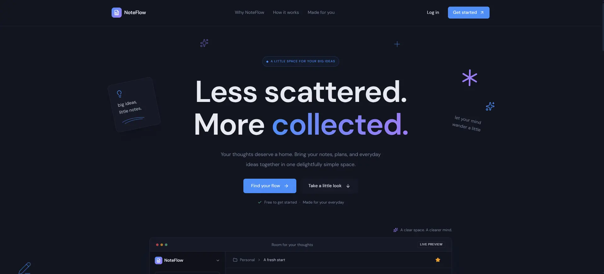
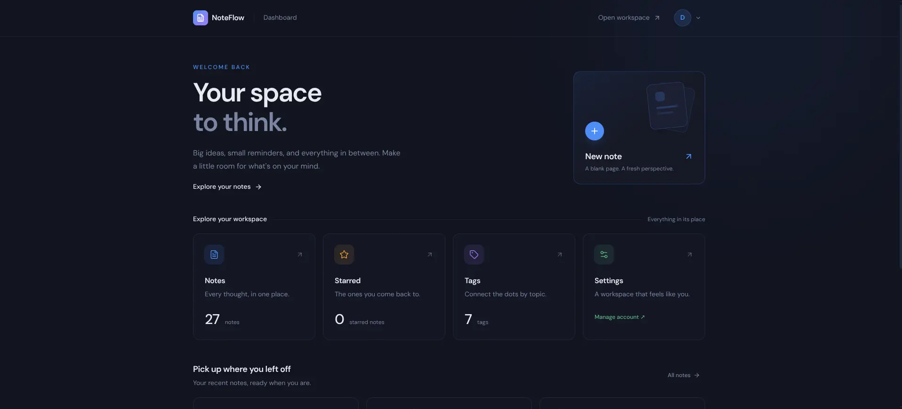
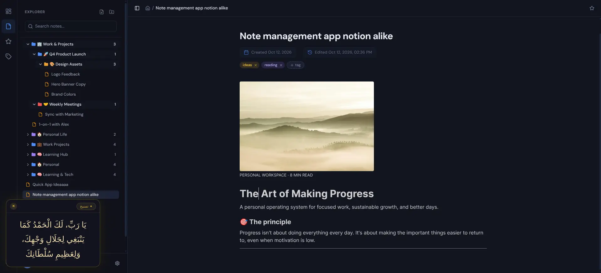
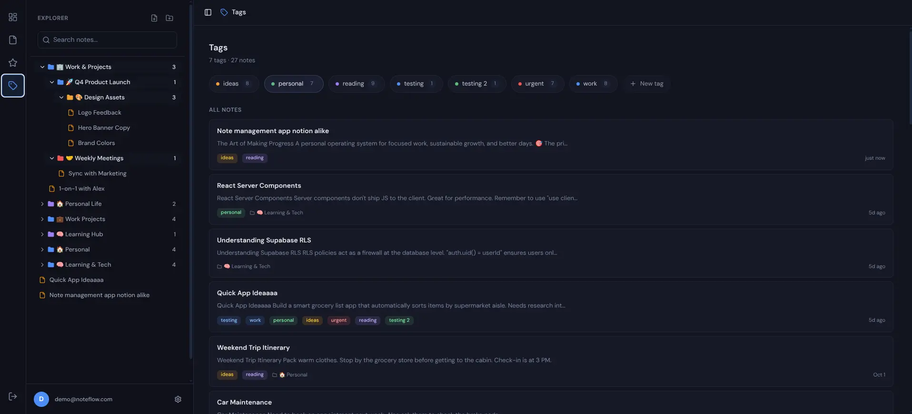
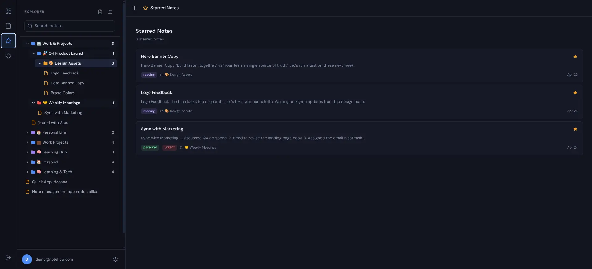
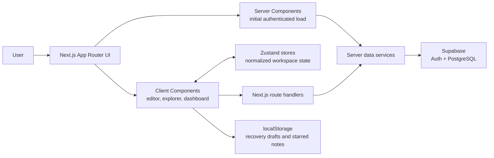

# NoteFlow

**A full-stack personal knowledge workspace for capturing, organizing, and returning to ideas.**

NoteFlow is a responsive note-taking application built independently with modern React and Next.js. It combines a rich-text editor with nested folders, tags, starred notes, search, and account-based data isolation. The project focuses on the parts that make a writing experience dependable: fast optimistic interactions, automatic saving, and local draft recovery when a browser session is interrupted.

> This repository is intended as a code sample for technical reviewers and hiring teams. It demonstrates product-minded frontend work alongside authentication, server-side data access, API design, client-state management, and focused automated testing.

## Contents

- [What it does](#what-it-does)
- [Screenshots](#screenshots)
- [Technical highlights](#technical-highlights)
- [Technology](#technology)
- [Architecture](#architecture)
- [Project structure](#project-structure)
- [Getting started](#getting-started)
- [Data model and security](#data-model-and-security)
- [Quality checks](#quality-checks)
- [Current scope and next steps](#current-scope-and-next-steps)

## What it does

### Account and workspace

- Email/password sign-up, sign-in, sign-out, and route protection through Supabase Auth.
- A personalized dashboard with recently edited notes and quick access to notes, starred notes, and tags.
- A responsive workspace: desktop navigation with a collapsible explorer and a mobile bottom navigation.

### Writing and recovery

- A rich-text editor powered by BlockNote, supporting structured content such as headings, lists, and checklists.
- A separate editable note title rather than deriving a title from the first line of the body.
- Debounced autosave with visible saving, saved, and error states.
- Local browser drafts, automatic recovery when the server version has not changed, and a clear conflict choice when it has.
- A safe save pipeline: client updates are optimistic for a responsive UI, and failed requests roll the in-memory state back without discarding the editor content.

### Organization and discovery

- Root and nested folders, inline creation, renaming, contextual actions, and cascading folder deletion.
- Predictable untitled names that are unique among sibling notes or folders.
- In-workspace title search.
- Tags that can be created, assigned, removed, deleted, and used to filter notes.
- A starred-notes view for frequently used content.

## Screenshots

<table>
  <tr>
    <td width="50%"></td>
    <td width="50%"></td>
  </tr>
  <tr>
    <td align="center"><em>Landing page and interactive workspace preview</em></td>
    <td align="center"><em>Personal dashboard and recent notes</em></td>
  </tr>
  <tr>
    <td width="50%"></td>
    <td width="50%"></td>
  </tr>
  <tr>
    <td align="center"><em>Rich-text editor and hierarchical explorer</em></td>
    <td align="center"><em>Tag management and filtered notes</em></td>
  </tr>
</table>

<p align="center"></p>
<p align="center"><em>Starred notes view</em></p>

## Technical highlights

### Built end-to-end as a solo project

NoteFlow was designed and implemented independently, covering the product experience and the supporting application architecture. It demonstrates an ability to turn a polished interface into a maintainable full-stack product: designing responsive workflows, modeling user-owned data, handling authentication and persistence, and treating failure and recovery paths as first-class product concerns.

### Designed for reliable editing

Editing starts two independent processes: a short-delay local draft write and a debounced server save. Each change carries a revision number, which prevents an older save completion from clearing a newer draft. On reopening a note, NoteFlow compares the stored draft with its server baseline to decide whether it can restore safely or should let the user choose between the versions.

### Responsive without sacrificing data integrity

Notes, folders, and tag assignments update immediately in the Zustand store. The app then persists the change through a Next.js route handler; if the request fails, the affected change is reversed. Deletion also guards against a late autosave restoring an item that was already removed.

### Clear separation of concerns

The codebase is organized by feature rather than by technical layer. Each feature owns its components, state, types, API-facing code, and public exports. Server Components load the authenticated workspace initially; Client Components manage interactive state and editing. This keeps feature boundaries explicit while avoiding unnecessary client-side loading spinners.

### Authentication-aware data access

All server data services resolve the active Supabase user before operating. Note, folder, and tag reads are scoped by `userId`; updates and deletes also include it in their query. The Supabase SSR client keeps authentication cookies synchronized across server rendering and requests.

## Technology

| Area | Tools used | Purpose in this project |
| --- | --- | --- |
| Framework | Next.js 16, React 19, TypeScript | App Router application, typed UI, route handlers, and server/client rendering boundaries |
| Styling and UI | Tailwind CSS 4, shadcn/ui, Radix UI, Lucide | Responsive design system, accessible primitives, and interface icons |
| Editor and motion | BlockNote, Framer Motion | Rich-text editing and polished landing-page interactions |
| Backend platform | Supabase Auth, Supabase PostgreSQL, `@supabase/ssr` | Authentication, cookie-aware sessions, and persistent user data |
| Client state | Zustand, Immer | Normalized workspace state, optimistic updates, and small focused stores |
| Validation and utilities | Zod, `uuid`, `clsx`, `tailwind-merge` | Input validation, IDs, and class composition |
| Testing and tooling | Vitest, ESLint, pnpm | Unit/API-route tests, static analysis, and package management |

## Architecture



1. Protected layouts fetch the signed-in user's folders, notes, and tags in parallel on the server.
2. Initial data hydrates the client stores once and remains available while the user navigates the workspace.
3. Interactions update the store optimistically and call an internal API route for persistence.
4. The editor also keeps an independent local draft so an unsaved change can survive a refresh or interrupted request.

## Project structure

```text
app/
  (public)/                 Landing, authentication, legal pages
  (protected)/dashboard/    Authenticated dashboard and workspace routes
  api/                      Route handlers for notes, folders, tags, and assignments
features/
  auth/                     Session UI and Supabase authentication flows
  dashboard/                Dashboard composition and recent-note experience
  explorer/                 Tree navigation, search, and contextual node actions
  landing/                  Marketing page, preview workspace, and motion
  nodes/                    Notes/folders, editor, drafts, persistence, and hierarchy utilities
  starred/                  Device-local starred note state and views
  tags/                     Tag UI, optimistic assignment workflow, and persistence
shared/
  components/               Reusable layout and shadcn-based UI components
  lib/                      Supabase clients, time formatting, browser storage, and helpers
docs/                       Implementation notes and database diagram
```

## Getting started

### Prerequisites

- Node.js 20 or newer
- pnpm
- A Supabase project with email/password authentication enabled

### Installation

```bash
git clone https://github.com/youseffswd/note-management.git
cd note-management
pnpm install
```

Create `.env.local` with the public Supabase project credentials:

```bash
NEXT_PUBLIC_SUPABASE_URL=your_supabase_project_url
NEXT_PUBLIC_SUPABASE_ANON_KEY=your_supabase_anon_key
```

Then start the development server:

```bash
pnpm dev
```

Visit [http://localhost:3000](http://localhost:3000).

### Useful commands

| Command | Description |
| --- | --- |
| `pnpm dev` | Run the local Next.js development server |
| `pnpm build` | Create a production build |
| `pnpm start` | Serve a production build |
| `pnpm test --run` | Run the Vitest suite once |
| `pnpm lint` | Run ESLint |

## Data model and security

The core relational model is intentionally small:

```text
profiles  1 ─── * folders
profiles  1 ─── * notes
folders   1 ─── * folders       (nested hierarchy)
folders   1 ─── * notes
profiles  1 ─── * tags
notes     * ─── * tags          (note_tags join table)
```

Notes persist their rich-text document as JSON content, while folders hold a self-referencing `parentId`. Tag assignment uses the `note_tags` join table, which keeps tags reusable and avoids duplicating tag data in note records. The repository includes an early schema reference at [`docs/db-shema.sql`](docs/db-shema.sql); a local Supabase setup must also include the `tags` and `note_tags` tables used by the current application.

The application checks authentication in every server-side data service and scopes operations to the authenticated user. For a production deployment, configure Supabase Row Level Security policies to enforce the same ownership rules directly in the database.

## Quality checks

The test suite covers the logic where regressions would be most costly: draft metadata migration, time formatting, generated names, folder traversal/deletion, note previews, starred-state isolation, tag assignment ordering and rollback, node-store edge cases, and the tag-assignment route.

```bash
pnpm test --run
```

Current result: **10 test files and 83 tests passing**.

`pnpm lint` is included as a project command. At the time this README was written, it reports five existing `react/no-unescaped-entities` errors in the public legal pages and error page; resolving those is a small cleanup item before enforcing lint as a CI gate.

## Current scope and next steps

- **Starred notes are device-local.** They are stored in browser storage and intentionally do not yet sync between devices; notes, folders, tags, and tag assignments are persisted in Supabase.
- **Database setup should be versioned.** The project has a schema reference, but a complete Supabase migration—including tag tables and Row Level Security policies—would make first-time setup and deployment reproducible.
- **End-to-end coverage is a natural next layer.** The existing unit and route tests cover core behavior; Playwright-style browser tests could cover authentication, editor recovery, and full workspace journeys.
- **Collaboration and sharing** would be a meaningful future product expansion once a clear permission model is defined.

## Repository

[View the source on GitHub](https://github.com/youseffswd/note-management)
