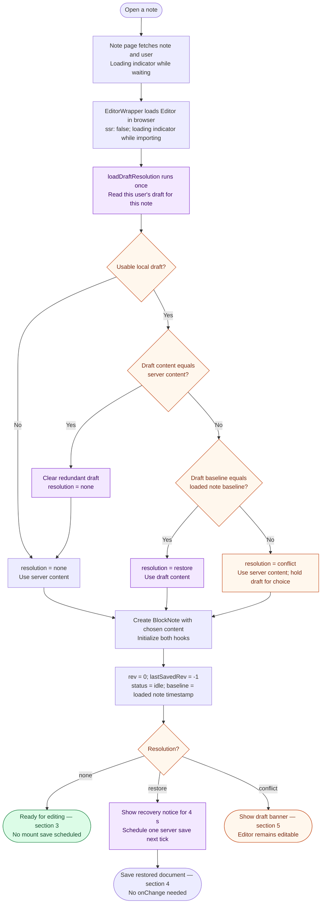
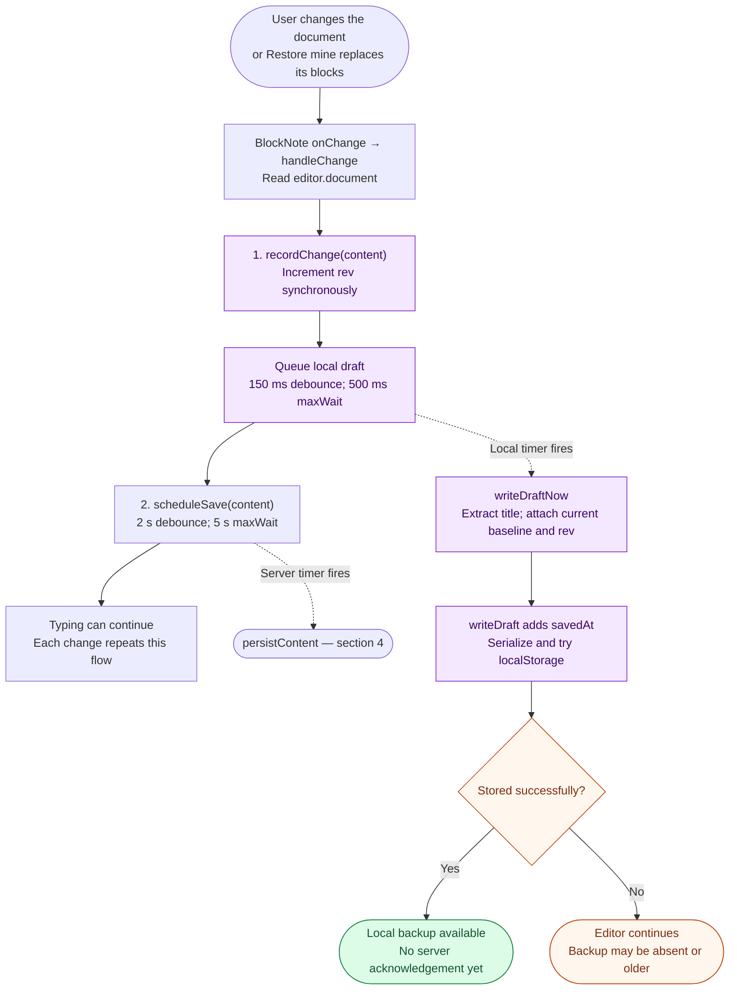
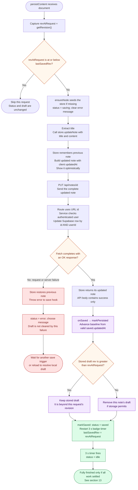
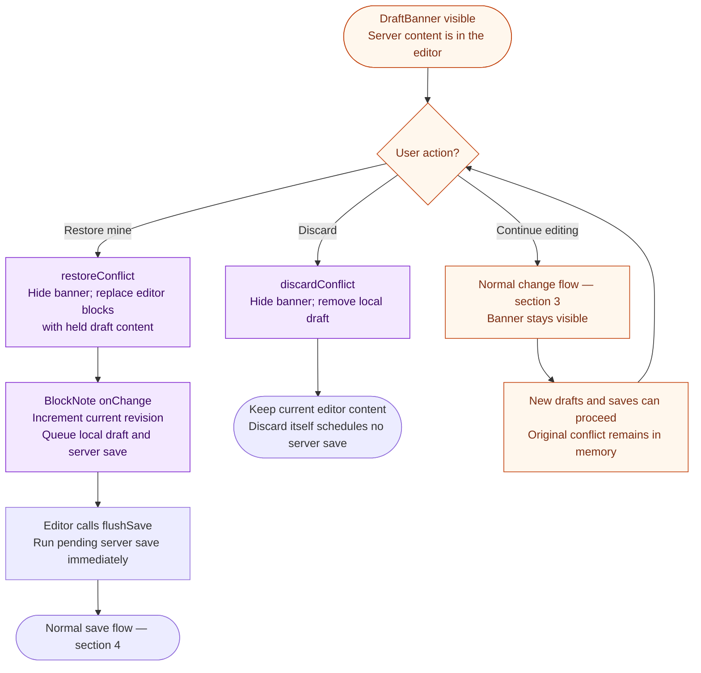
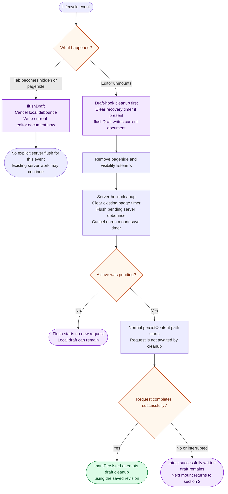
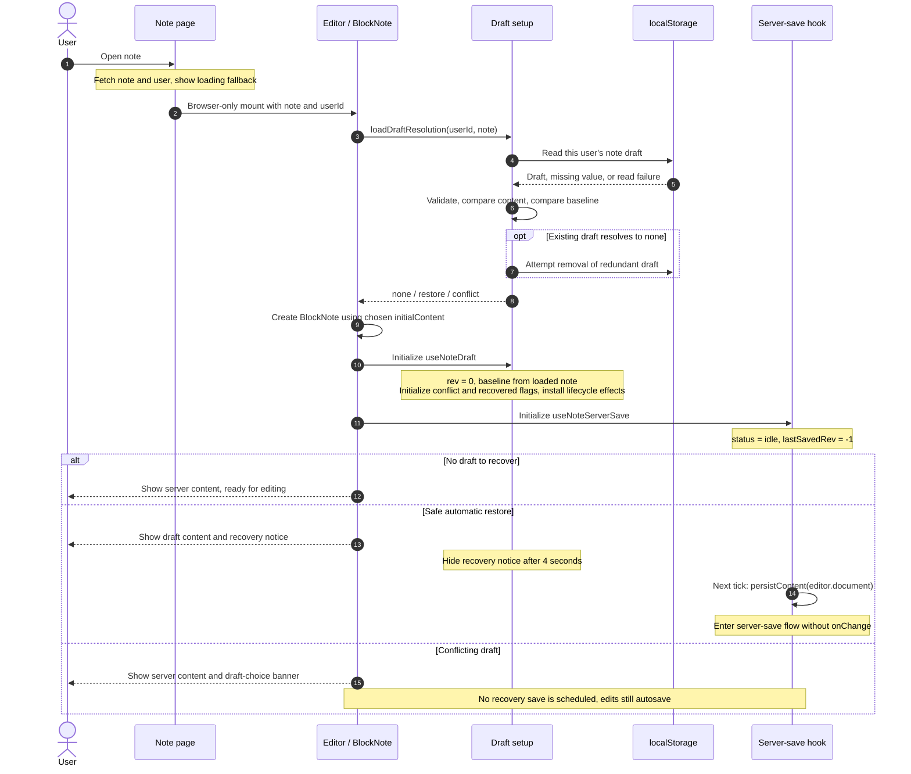
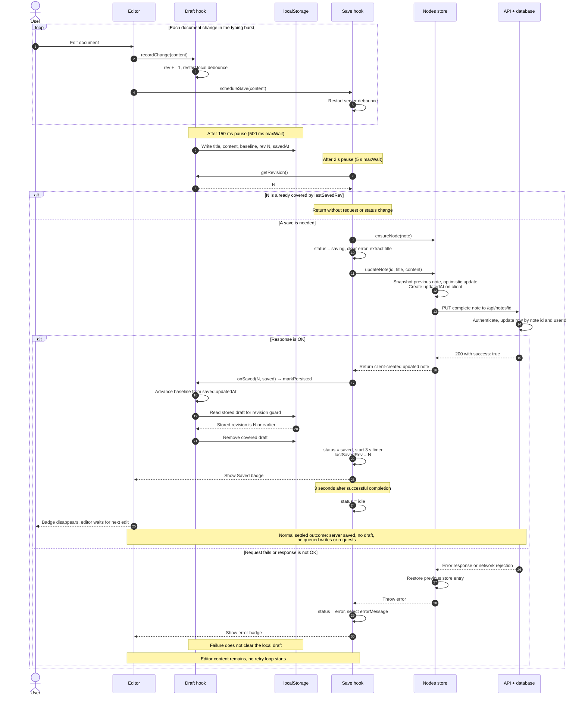
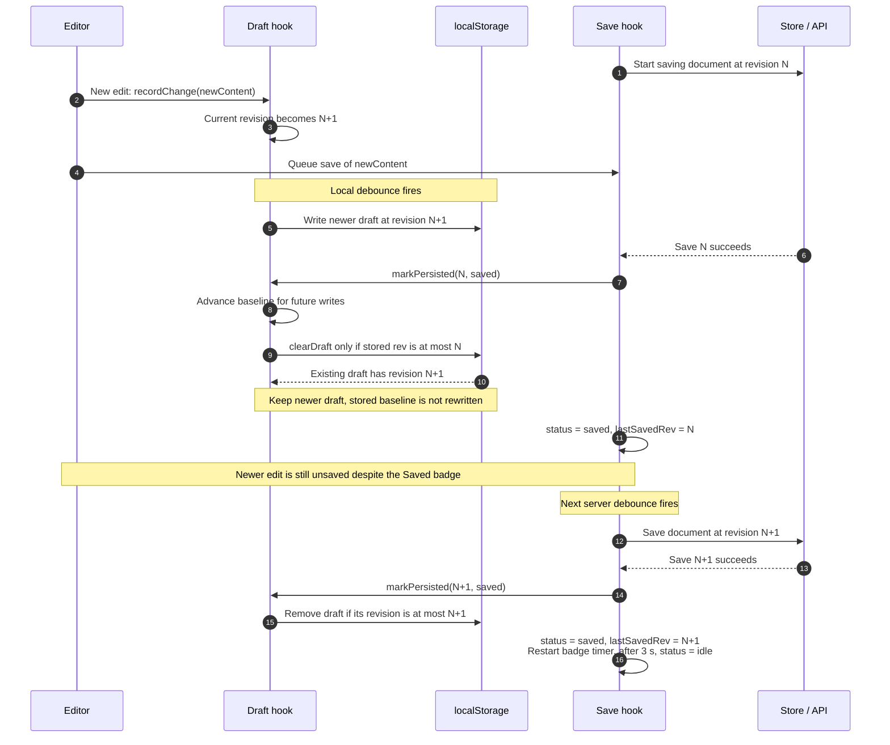
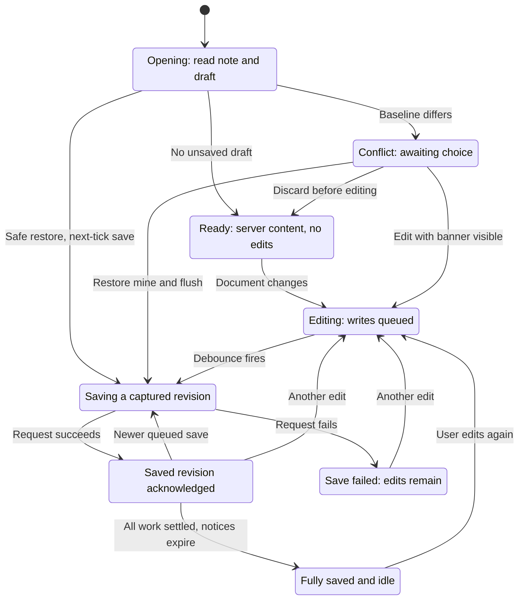
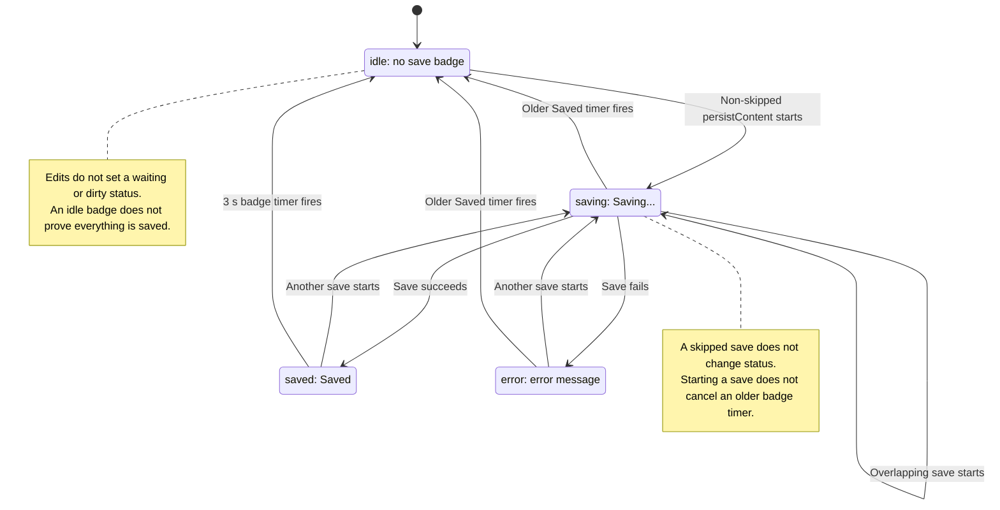

# Note editor: from opening a note to saved and idle

This document follows the current working-tree implementation of `Editor`, `useNoteDraft`, and `useNoteServerSave`, including the store, API, and database. It describes current behavior, including the cases where saving or draft cleanup is incomplete.

**Read the [visual HTML version](note-editor-flow.html) in a browser for rendered diagrams, zoom controls, and navigation.** It works offline. The Mermaid diagrams below are the editable source for those visuals.

The normal journey is: **open the note → resolve any local draft → edit → write a local backup → save to the server → clear the covered draft → show “Saved” → return to idle.**

## Reading guide

- [1. Who does what](#1-who-does-what)
- [2. Flowchart — opening the editor](#2-flowchart--opening-the-editor)
- [3. Flowchart — an edit starts two independent timers](#3-flowchart--an-edit-starts-two-independent-timers)
- [4. Flowchart — the complete server save](#4-flowchart--the-complete-server-save)
- [5. Flowchart — resolving a conflicting draft](#5-flowchart--resolving-a-conflicting-draft)
- [6. Flowchart — hiding or leaving the page](#6-flowchart--hiding-or-leaving-the-page)
- [7. UML sequence — opening a note](#7-uml-sequence--opening-a-note)
- [8. UML sequence — editing, saving, and returning to idle](#8-uml-sequence--editing-saving-and-returning-to-idle)
- [9. UML sequence — typing during a save](#9-uml-sequence--typing-during-a-save)
- [10. State diagram — the editor lifecycle](#10-state-diagram--the-editor-lifecycle)
- [11. State diagram — the actual save indicator](#11-state-diagram--the-actual-save-indicator)
- [12. Timers and stored data](#12-timers-and-stored-data)
- [13. What “finished and idle” means](#13-what-finished-and-idle-means)
- [14. Current implementation limits](#14-current-implementation-limits)
- [15. Source map](#15-source-map)

Flowcharts read from top to bottom. Diamonds ask a question; labeled arrows show the answer. Blue boxes describe editor/server work, purple boxes describe local drafts, green boxes describe a successful outcome, and amber/red boxes describe a decision or failure. Text labels carry the meaning even without color. Separate charts connect through their numbered titles.

## 1. Who does what

| Part | Responsibility |
| --- | --- |
| Note page and `EditorWrapper` | Fetch the note and user, show loading indicators, then load the editor in the browser with `ssr: false`. |
| `Editor` / BlockNote | Choose starting content once, display the document and banners, and send every document change to both hooks. |
| `useNoteDraft` | Own the edit revision, conflict/recovery notices, and fast local backup. Flush that backup when hiding or leaving. |
| `useNoteServerSave` | Debounce server saves, call the store, report save status, and notify the draft hook after success. |
| Draft utilities / `localStorage` | Read, validate, compare, write, and remove the per-user, per-note backup on this browser. |
| Nodes store | Update the in-memory note immediately, send the PUT request, and roll back that store entry if the request fails. |
| API and note service | Authenticate the user and update the matching note in Supabase. |

**Terms used in the diagrams:**

| Term | Plain-language meaning |
| --- | --- |
| **Debounce** | Wait for a pause in typing before doing work. New changes restart the wait; `maxWait` prevents continuous typing from postponing it indefinitely. |
| **Revision / `rev`** | A counter for this editor mount. Starts at `0`; each `onChange` increments it. It is not a database version. |
| **`revAtRequest`** | The revision captured when a server save actually starts. |
| **`lastSavedRev`** | The revision recorded by the latest successful completion in this hook. Starts at `-1`, allowing a restored note at revision `0` to be saved. |
| **Baseline / `baseUpdatedAt`** | The timestamp of the server note the draft was based on. At load, use valid `updatedAt`, otherwise valid `createdAt`, otherwise `null`. |
| **Optimistic update** | Show the changed note in the client store before the server confirms it. |
| **Flush** | For the draft: cancel its timer and write the current editor document now. For the server: execute an already queued debounced save now. |

## 2. Flowchart — opening the editor

The draft decision runs **before BlockNote is created**. BlockNote reads `initialContent` once, so changing that value later would not perform recovery.

A missing draft or unavailable storage follows “No.” Invalid JSON, a mismatched user/note ID, non-array content, or an invalid `savedAt` makes the draft unusable; removal is attempted. This is a shallow validation, not a validation of every BlockNote block or draft field.

Content comparison uses `JSON.stringify` equality. Baselines are compared by **equality**, not by which timestamp is newer. `savedAt` is used for the banner's date, not for deciding whether to restore.

The opening diagrams assume the page successfully loads an authenticated user's note. A fetch/authentication error happens before the editor flow; if the separate user result is absent, `NoteDataFetcher` renders nothing.

## 3. Flowchart — an edit starts two independent timers

The two hook calls happen in order, but their timers run independently. The server save does **not** wait for the local write to succeed.

For both writes, the title comes from the **first text run in the first block**, trimmed. If that text is absent or empty, the hook retains its last title, initially `note.title`. The whole document is saved as content; title extraction does not scan the whole document.

`recordChange` does not change the save badge. During the debounce wait, it can still show nothing, “Saved,” or an earlier error. An edit can also arrive while a request is in progress.

## 4. Flowchart — the complete server save

This path is entered by a server debounce, the one-time recovery save, or a flush of a pending save. Each invocation captures its revision when it starts.

The service stores `title`, JSON-stringified `content`, `folderId`, and the supplied `updatedAt`. The timestamp is created in the **client store**, sent to the service, and reused for the local baseline after success. The API does not return a fresh database note, and the store does not parse the response body.

The rollback changes the **store entry**, not the document currently visible in BlockNote. The user's in-editor edits remain available for the next save attempt.

| Failure detected by the hook/store | Displayed message |
| --- | --- |
| Browser reports offline | `Offline. Saved on this device.` |
| `TypeError` whose message includes `fetch`, while not reporting offline | `Network error. Saved on this device.` |
| HTTP 401 | `Session expired. Please sign in again.` |
| Other non-OK HTTP response | `Failed to update note` |
| Other thrown `Error` | Its message; otherwise `An error occurred` |

The two “Saved on this device” messages are not based on a checked storage acknowledgement. Local writes can fail silently. There is no automatic retry loop or reconnect listener: a later edit, an existing queued save, a pending-save flush, or recovery on a later mount must trigger another attempt.

## 5. Flowchart — resolving a conflicting draft

A conflict means the stored draft differs from the loaded server content **and** its baseline does not match. The server content is initially shown; the old draft is held in the draft hook's `conflict` state.

“Restore mine” replaces the document in one undoable transaction; it does not merge the two versions. It uses the current mount's revision counter and baseline. It does not show the automatic-recovery notice, which is only initialized for `resolution = restore`.

The banner does not pause autosave. If the user edits before choosing, “Discard” keeps that current editor content and can remove the newer local backup; it does not cancel already queued writes. A page-hide flush can also replace the on-disk conflict with the current editor document. The choices above describe what the current handlers actually do.

## 6. Flowchart — hiding or leaving the page

Hiding and unmounting are different events. Both can write a local draft, including when the note was already saved.

The draft hook is declared before the server-save hook so its unmount write precedes the server flush. The recovery notice's cleanup also clears its timer; listener removal and the draft flush are separate effect cleanups.

The local write is synchronous **when the event runs and storage succeeds**. A crash or process kill may run no cleanup at all; only the last completed local write is recoverable. The PUT uses normal `fetch`, without `keepalive` or a beacon, so page closure can interrupt it. An already running request is not cancelled or awaited on unmount.

## 7. UML sequence — opening a note

This sequence shows the order of initialization and the three possible draft decisions. “Draft setup” includes the utility decision before BlockNote creation, followed by `useNoteDraft` initialization.

## 8. UML sequence — editing, saving, and returning to idle

The success branch below is the normal case: no conflicting draft, one burst of edits, no overlapping requests, successful local storage, and no new edits or lifecycle events before completion. “API + database” expands to the authenticated service path in section 4.

## 9. UML sequence — typing during a save

This illustrates the revision guard when the newer local write has completed before the older request returns. It assumes requests finish in order; the hook does not enforce that order.

If save N returns **before** the local timer writes N+1, the guard sees only the older stored draft and may remove it. The pending draft write can recreate the backup later. The revision is incremented immediately in memory, but draft removal checks the **stored** revision, not the live counter.

## 10. State diagram — the editor lifecycle

These are explanatory states for understanding the whole workflow. They are **not** additional React state variables. The normal completion path assumes successful storage and no out-of-order save completions; section 14 describes the exceptions.

Editing remains possible during a request and queues another save. If the banner is discarded **after** new edits, those edits remain in the Editing/Saving lifecycle. “Ready” already has saved server content without ever going through a server save in this mount.

**From any state:** tab hiding writes a draft without ending the lifecycle; unmount runs the flush/cleanup flow in section 6 and leaves the editor. Opening the note again starts at Opening, where any remaining draft is resolved.

## 11. State diagram — the actual save indicator

This diagram uses the exact `SaveStatus` values from `useNoteServerSave`. Unlike the lifecycle diagram, it represents what the badge code stores.

Every successful request completion sets `saved` and replaces the badge timer; every caught failure sets `error`. If requests overlap, either completion can arrive after another has changed the status, so the four values are not a request queue or a reliable count of work in progress. The diagram shows the ordinary request path and the older-timer transitions explicitly.

Two additional pieces of UI state belong to the **draft hook** and run independently:

| UI state | Starts visible when | Becomes hidden when |
| --- | --- | --- |
| Recovery notice | Initial resolution is `restore` | Its 4-second timer fires, or the editor unmounts. Saving does not hide it. |
| Conflict banner | Initial resolution is `conflict` | Restore mine or Discard is chosen, or the editor unmounts. A successful save alone does not hide it. |

## 12. Timers and stored data

| Work | Trigger / timing | What happens |
| --- | --- | --- |
| Local draft | 150 ms after a change pause; 500 ms `maxWait` during continuous changes | Store a snapshot on this browser. |
| Server save | 2 s after a change pause; 5 s `maxWait` during continuous changes | Attempt to persist the document. |
| Recovery save | `setTimeout(..., 0)` on a restored mount | Save content that was installed without `onChange`. The one-time flag is set inside the callback, so a cancelled setup does not consume it. |
| Saved badge | 3 s after a successful completion | Set the status to `idle`. Another successful completion restarts this timer. |
| Recovery notice | 4 s after recovered state is initialized | Hide the recovery notice independently of save status. |
| Draft flush | Hidden visibility, `pagehide`, and unmount | Cancel the draft debounce and write the current document immediately. |
| Server flush | Restore mine and unmount | Invoke an already pending server save immediately; it is not an unconditional save of `editor.document`. |

These are configured timer delays, not real-time deadlines. Network duration is additional; background-tab throttling can delay timers. The two `maxWait` values cap debounce postponement, not the time to complete a request.

**Local storage key:** `note-draft:v1:<userId>:<noteId>`.

| Draft field | Purpose |
| --- | --- |
| `noteId`, `userId` | Identify the note and account. |
| `title`, `content` | Backed-up title and complete BlockNote document. Restore installs the content; it does not seed the hooks' title refs from the stored title. |
| `savedAt` | Local write time in epoch milliseconds; used for the banner date. |
| `baseUpdatedAt` | Timestamp of the note version the draft continues from; may be `null`. |
| `rev` | Editor-mount revision attached to this snapshot; used by conditional removal. |

Writes that cannot be serialized or exceed **524,288 serialized characters** are skipped. If `setItem` throws, the utility removes this user's **other** note drafts and retries once. A second failure is silent. Reads/removals also tolerate unavailable storage. These operations do not set the server-save status.

The hooks keep revision, baseline, and title in refs so those value changes do not replace the debounced callbacks. The save hook also refreshes its note ref when the note prop changes. Draft resolution and BlockNote initial content are still initialized only once per editor mount.

## 13. What “finished and idle” means

For an ordinary edit/save cycle to be fully settled, all of the following should be true:

1. The latest editor document has been acknowledged by the save path; no newer edits remain unsaved.
2. No local write or server save is queued, and no request is still in flight.
3. The covered local draft has been removed, or a known redundant draft remains only because of a later lifecycle write or the recovery revision issue below.
4. The baseline reflects the timestamp used by the latest successful save.
5. The 3-second badge timer has fired, so `saveStatus = idle`; the 4-second recovery notice, if used, has also expired.
6. No conflict remains unresolved.

After normal editing with requests completing in order, `lastSavedRev === getRevision()` is a useful supporting condition. On a fresh, untouched mount, `lastSavedRev = -1` and `rev = 0` even though the editor is already displaying saved server content. The code does not compute one combined “everything finished” flag, and counter equality alone cannot rule out an older in-flight request.

For one edit at time zero, a local draft is normally written around **0.15 s**, the PUT starts around **2 s**, “Saved” appears when that request completes, and the badge disappears **3 s after that completion**. That is about **5 s plus the request duration** to return to an empty save indicator, assuming no further changes.

Hiding a fully saved note can recreate a redundant local draft without making its content unsaved. On the next opening, equal server/draft content makes `loadDraftResolution` remove that draft.

## 14. Current implementation limits

These details explain why some paths do not reach the completely clean endpoint shown in the normal sequence. They are observations about the current source, not changes implemented by this document.

| Situation | What the code currently does |
| --- | --- |
| Automatic recovery uses an old draft revision | The new hook starts at revision `0` rather than adopting the stored revision. If the restored draft has `rev > 0`, the successful mount save at revision `0` retains it. A later load with matching server content clears it; later local writes/saves may also replace and clear it. |
| A new edit exists only in memory | Conditional removal reads the on-disk revision. An older save can clear the existing backup before the newer 150 ms write runs. |
| A newer draft is retained after an older save | `markPersisted` advances the baseline ref, but does not rewrite the retained draft's baseline. Reloading before a subsequent local write/save may produce a conflict even if the earlier update was from this editor. |
| Saves overlap | There is no in-flight lock, cancellation, ordered request queue, or version check in the API. Later/earlier completions can overwrite status, roll back the store, or regress `lastSavedRev`/baseline. The revision check only skips work already acknowledged when a request starts. |
| The previous badge timer is still running | Starting a new request or recording an error does not clear it. It can change `saving` or `error` to `idle`. With no such prior timer, an error stays visible until another attempt changes it. |
| Save completes after unmount | The cleanup has already cleared the then-existing status timer, but a late successful completion still calls `markSaved` and can create another 3-second timer. |
| Local storage fails or the document is too large | Autosave can still succeed, but a current local backup is not guaranteed, even if the error badge says it is saved on this device. |
| Conflict remains while editing | Editing, backup writes, and server saves are allowed. The banner's original snapshot stays in memory, while the on-disk draft can be overwritten or removed. |
| Another device or tab changes the note | Conflict detection runs on mount only. There is no live storage-event reconciliation or server-side baseline comparison; tabs share the same storage key but have independent revision counters. |
| API returns an OK result | The service checks for a Supabase error but does not verify that a row was actually updated or read it back. “Saved” means this code received an OK response, not that it reconciled a returned database version. |
| Logout cleanup | `clearAllDrafts` exists and is exported, but no call site was found in the current application. Automatic logout deletion is not part of this flow. |

## 15. Source map

| File | Relevant part of the flow |
| --- | --- |
| [Note page](../app/%28protected%29/dashboard/notes/%5Bnote%5D/page.tsx) | Server-side note/user loading and loading fallback. |
| [EditorWrapper.tsx](../features/nodes/components/EditorWrapper.tsx) | Browser-only dynamic editor mount. |
| [Editor.tsx](../features/nodes/components/Editor.tsx) | Initial resolution, hook order, change handler, restore/flush wiring, and indicators. |
| [use-note-draft.ts](../features/nodes/hooks/use-note-draft.ts) | Local debounce, revision, baseline, recovery, conflict handlers, and lifecycle flushes. |
| [use-note-server-save.ts](../features/nodes/hooks/use-note-server-save.ts) | Request guard, server debounce, status, recovery save, and unmount flush. |
| [note-draft.ts](../features/nodes/utils/note-draft.ts) | Storage format, validation, resolution, conditional removal, and quota handling. |
| [extract-title.ts](../features/nodes/utils/extract-title.ts) | First-block/first-text-run title extraction and fallback. |
| [DraftBanner.tsx](../features/nodes/components/DraftBanner.tsx) | Conflict date and user choices. |
| [nodes.store.ts](../features/nodes/store/nodes.store.ts) | Store seeding, optimistic update, client timestamp, PUT, and rollback. |
| [Note API route](../app/api/notes/%5Bid%5D/route.ts) | URL note ID, request parsing, and success/error response. |
| [nodes.service.ts](../features/nodes/api/nodes.service.ts) | Authenticated Supabase reads and writes. |
| [Explorer.tsx](../features/nodes/components/Explorer.tsx) | Normal store initialization; explains why direct editor loads also call `ensureNode`. |

Scope: opening and editing an existing note through the editor save lifecycle. Note creation, deletion, and folder operations are outside this flow. The diagrams describe the code as inspected on 2026-09-29, including the working-tree hook refactor.
