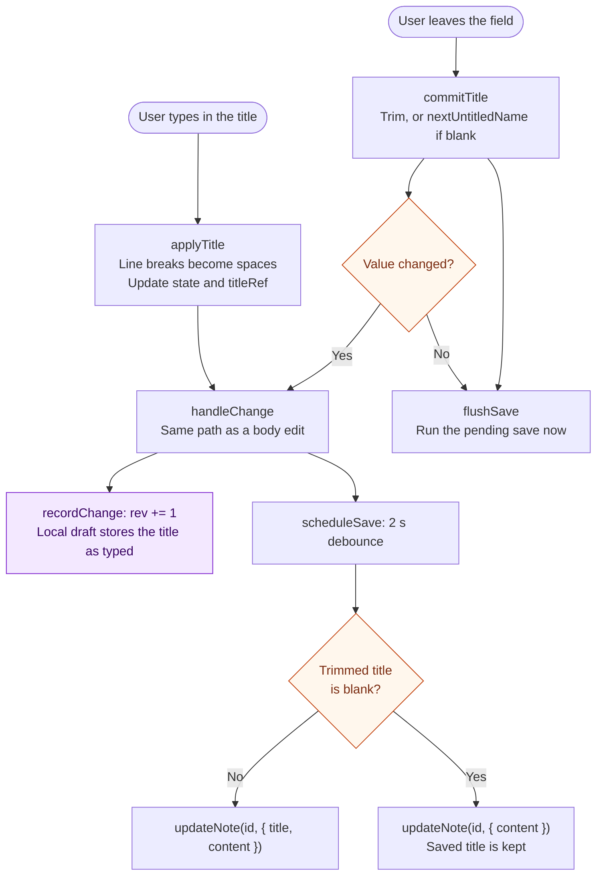
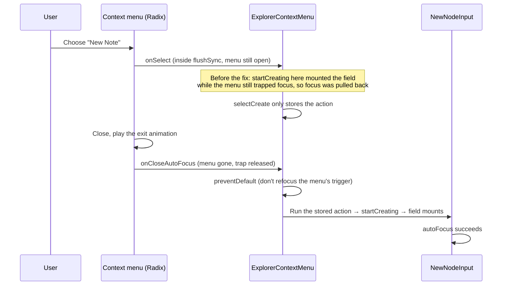
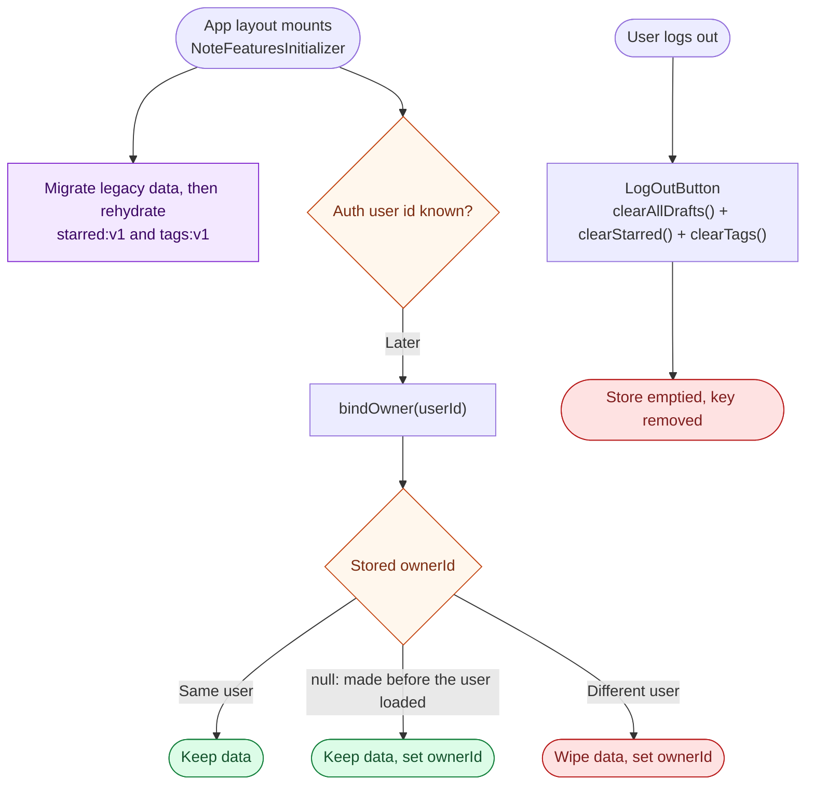

# Note features: separate titles, inline naming, stars and tags

This document describes four features added together, as they exist in the current working tree (not yet committed):

1. **The note title is its own field.** It is no longer taken from the first line of the note body.
2. **New notes and folders are named inline** in the explorer. A blank name becomes "Untitled Note" / "Untitled Folder", with a counter when that name is taken.
3. **A note can be starred and tagged** from the note page. Only the front end is built; there are no database tables for stars or tags yet.
4. **The Starred and Tags pages** list notes as cards, following the `noteflow.html` mockup.

For each feature it covers what the user sees, how it works, which files were created or changed and why, and what is still missing. [Section 7](#7-file-index) lists every touched file in one table.

The note editor's save pipeline (drafts, debounced saves, conflicts) is documented in [note-editor-flow.md](note-editor-flow.md). This document only describes how the title now goes through that pipeline.

**The [visual HTML version](note-features.html) is an offline snapshot from before the feature separation.** This Markdown document describes the current structure.

## Reading guide

- [1. Summary](#1-summary)
- [2. Feature 1: the title is its own field](#2-feature-1-the-title-is-its-own-field)
- [3. Feature 2: naming new notes and folders inline](#3-feature-2-naming-new-notes-and-folders-inline)
- [4. Feature 3: starring and tagging a note](#4-feature-3-starring-and-tagging-a-note)
- [5. Feature 4: the Starred and Tags pages](#5-feature-4-the-starred-and-tags-pages)
- [6. Moving stars and tags to the backend](#6-moving-stars-and-tags-to-the-backend)
- [7. File index](#7-file-index)
- [8. Tests and verification](#8-tests-and-verification)
- [9. Known limits and follow-ups](#9-known-limits-and-follow-ups)

Flowcharts read from top to bottom. Diamonds ask a question; labeled arrows show the answer. Blue boxes are app and server work, purple boxes are the browser's local storage, amber boxes are decisions, green boxes are outcomes where data is kept, and red boxes are where data is wiped. Text labels carry the meaning even without color.

## 1. Summary

| Feature | User-facing result | Main pieces |
| --- | --- | --- |
| Separate title | A large title field above the body. Enter moves into the body. Blank becomes "Untitled Note". | `Editor`, `useNoteDraft`, `useNoteServerSave`, `note-draft` |
| Inline naming | "New Note" / "New Folder" opens a name field in the tree. Enter or clicking away creates the node; Escape cancels. | `explorer.store`, `NewNodeInput`, `Explorer`, `FolderItem`, `ExplorerContextMenu`, `untitled-name` |
| Stars and tags | A star button in the header and a tags row under the title, with a picker to add or create tags. | `starred.store`, `tags.store`, `StarButton`, `NoteActions`, `NoteTags`, `TagBadge`, `popover` |
| Starred and Tags pages | Note cards with preview, tags, folder and relative time. Tag chips with counts filter the list. | `StarredNotesView`, `TagsView`, `NoteCard`, `SectionTitle`, `note-preview`, `relative-time` |

Nothing on the server changed: the API routes, `nodes.service.ts`, `nodes.store.ts` and the database schema are untouched. The `notes.title` column already existed; it simply stops being derived from the body.

### Feature ownership

- `features/nodes`: notes, folders, editor, explorer, and reusable note cards.
- `features/tags`: tag types, colors, store, picker, badges, and Tags view.
- `features/starred`: starred state, star button, and Starred view.
- Pages and `shared/components/layout` compose the features through their public `index.ts` exports. `NoteActions` belongs to the layout; `NoteView` receives the tag picker as children.

The stores still use browser storage and retain the existing account and logout behavior. The migration is in [`shared/lib/migrate-note-meta.ts`](../shared/lib/migrate-note-meta.ts).

## 2. Feature 1: the title is its own field

### What the user sees

- A large title field sits at the top of the note, above the created/edited dates and the tags row. It is aligned with the body text.
- Typing in it saves like typing in the body: the same "Saving…" / "Saved" indicator and the same local crash-recovery draft.
- **Enter** moves the cursor to the start of the body, the way Enter at the end of a heading would.
- A title is one line. Pasted line breaks become spaces.
- Leaving the field (clicking elsewhere, Tab, or Enter) settles the title. Surrounding spaces are trimmed, and a blank title becomes "Untitled Note" (or "Untitled Note 2", and so on, if a sibling already uses that name). The save then happens right away instead of after the 2-second debounce.
- The sidebar and the header breadcrumb show the new title once the save runs.
- New notes start with an empty body. They used to start with an "Untitled Note" heading, which also served as the title.

### Why it changed

The title used to be extracted from the first text run of the first block (`extractTitle`). That coupled the title to the content: deleting the first line renamed the note, and the title could not be edited without editing the body. The `notes.title` column already existed, so the title now has its own input and is saved to that column directly.

### How it works

The title is part of the same save pipeline as the body, not a separate request. Title edits therefore share the body's revision counter, local draft, debounce and error handling, and a title change can never race a content save.



Key points:

- **`titleRef` and `getTitle`.** `Editor` keeps the title in React state (for rendering) and in a ref. Both hooks receive `getTitle()` and read the ref at the moment they run. The debounced callbacks therefore always see the latest title, and their identity never changes. `useDebounceCallback` rebuilds its timer when the callback changes, which would drop a pending save.
- **A blank title is never saved.** While the field is empty the user is presumably typing a new title, so the server save sends only the content and the old title stays. Leaving the field fills in an untitled name, which is then saved.
- **Drafts keep the title exactly as typed**, including blank. When a draft is restored silently, the editor opens with the draft's title, or with the note's title if the draft's is blank.
- **Draft comparison includes the title.** `resolveDraft` treats a draft as already saved only if its content matches and its title is blank or equal to the note's title. Otherwise a draft that differed only in its title would be discarded.
- **"Restore mine" restores the title too.** The title is set first, then the blocks are replaced. `handleChange` and `flushSave` are then called explicitly, because a draft that differs only in its title changes no blocks, and BlockNote would fire no `onChange`.
- **Empty bodies.** BlockNote throws if `initialContent` is an empty array. `initialBlocks()` passes `undefined` instead, which gives one empty paragraph.
- **Alignment.** BlockNote pads its blocks with `padding-inline: 54px`. The title, the metadata row and the tags row use `px-13.5` (54px), so all left edges line up.

Layout of the note page, top to bottom (all rendered by `Editor`):

```
DraftBanner (only on a conflict)
Save status indicator (absolute, top right)
Title field                         ← Editor
meta slot:  NoteMetadata (dates)    ← passed in by NoteView
            NoteTags (tags row)     ← composed by the note page through NoteView
BlockNote body
```

`NoteView` passes the dates and tags as a `meta` prop so they render between the title and the body. The title has to live inside `Editor`, because it shares the editor's save hooks.

### Files

| File | Status | What and why |
| --- | --- | --- |
| [`features/nodes/components/Editor.tsx`](../features/nodes/components/Editor.tsx) | Changed | Adds the title field: `title` state, `titleRef`/`getTitle`/`applyTitle`, `handleTitleChange`, `commitTitle` (blur), `handleTitleKeyDown` (Enter into the body). Passes `getTitle` to both hooks. Restores the title on "Restore mine". Adds the `meta` slot and the `initialBlocks` guard. |
| [`features/nodes/components/EditorWrapper.tsx`](../features/nodes/components/EditorWrapper.tsx) | Changed | Forwards the new `meta` prop through the client-only dynamic import. |
| [`features/nodes/components/NoteView.tsx`](../features/nodes/components/NoteView.tsx) | Changed | Renders `NoteMetadata` and its `children` through `meta`; the note page supplies `NoteTags`. |
| [`features/nodes/components/NoteMetadata.tsx`](../features/nodes/components/NoteMetadata.tsx) | Changed | Padding changed from `px-12 pt-12 pb-2` to `px-13.5 pt-4`. It now sits under the title and aligns with the body text. |
| [`features/nodes/hooks/use-note-draft.ts`](../features/nodes/hooks/use-note-draft.ts) | Changed | Takes `getTitle`. `writeDraftNow` stores `getTitle()` instead of extracting a title from the content. Its own title ref was removed. |
| [`features/nodes/hooks/use-note-server-save.ts`](../features/nodes/hooks/use-note-server-save.ts) | Changed | Takes `getTitle`. `persistContent` sends the trimmed title, or content only when it is blank. Its own title ref and `extractTitle` call were removed. |
| [`features/nodes/utils/note-draft.ts`](../features/nodes/utils/note-draft.ts) | Changed | `resolveDraft` compares the title as well as the content (a blank draft title counts as a match). |
| [`features/nodes/utils/create-empty-note.ts`](../features/nodes/utils/create-empty-note.ts) | Changed | Now `createEmptyNote(title, parentId)`. The body is a single empty paragraph instead of an "Untitled Note" heading. |
| [`features/nodes/utils/untitled-name.ts`](../features/nodes/utils/untitled-name.ts) | Created | `nextUntitledName`, shared with feature 2. Used here to name a note whose title was left blank; the note excludes itself so it can keep "Untitled Note". |
| `features/nodes/utils/extract-title.ts` | Deleted | No longer used. The title is not derived from the body anymore. |
| [`docs/note-editor-flow.md`](note-editor-flow.md) | Changed | The passages that described title extraction now describe the title field. |

### Limits

- **Existing notes are not migrated.** Notes created before this change still have their old title as the first heading of the body, so it shows twice (once in the title field, once in the body). Delete the heading by hand, or add a one-time cleanup.
- Titles are not required to be unique. Only the automatic "Untitled" names avoid clashes.

## 3. Feature 2: naming new notes and folders inline

### What the user sees

- **Where:** the New Note / New Folder buttons in the explorer header create at the root. So does right-clicking empty space in the explorer. Right-clicking a folder and choosing New Note / New Folder creates inside that folder; these menu items used to do nothing. The folder opens if it was collapsed.
- **What:** a highlighted row with a note or folder icon and a text field appears where the new item will land: after the other items at that level. The field is focused and its placeholder shows the name a blank field would get, for example "Untitled Folder 2".
- **Enter** creates the item with the typed name, or with the placeholder name if the field is blank.
- **Clicking away** (blur) does the same as Enter.
- **Escape** cancels; nothing is created.
- Creating a **note** opens it. Creating a **folder** just adds it to the tree.
- Only one field is open at a time. Clicking New Note / New Folder while a field is open first creates the open one (clicking the button blurs it), then opens a new field.

### Untitled names and the counter

`nextUntitledName(nodesHash, { type, parentId, excludeId? })` in [`untitled-name.ts`](../features/nodes/utils/untitled-name.ts):

- The base name is "Untitled Note" or "Untitled Folder".
- Only **siblings** count: nodes with the same parent and of the same type. A note called "Untitled Note" in another folder, or a folder called "Untitled Note", does not.
- Names are compared **case-insensitively and trimmed**, so "  untitled note " takes the base name.
- The result is the first free name among `Untitled Note`, `Untitled Note 2`, `Untitled Note 3`, … Gaps are filled: with "Untitled Folder" and "Untitled Folder 3" taken, the next one is "Untitled Folder 2".
- `excludeId` leaves one node out. Feature 1 uses it so a note named "Untitled Note" whose title is cleared gets "Untitled Note" back, not "Untitled Note 2".

### How it works

A small store holds the one node being named:

```ts
// features/nodes/store/explorer.store.ts
pendingNode: { type: "note" | "folder"; parentId: string | null } | null
startCreating(type, parentId)
stopCreating()
```

- `Explorer` renders `NewNodeInput` at the end of the root list when `pendingNode.parentId === null`.
- `FolderItem` renders it at the end of its children when `pendingNode.parentId === folder.id`, and forces itself open, because the field is inside the collapsible content.
- The field is placed last because the tree is ordered by creation time: the new node is appended, so it appears exactly where the field was and nothing jumps.
- `NewNodeInput` is keyed by type, so switching from a pending note to a pending folder remounts it with fresh state.

`NewNodeInput` creates the node on Enter or blur and cancels on Escape. A `settledRef` guard makes sure it runs only once: Enter unmounts the field, and unmounting can also fire blur. Keys pressed during IME composition are ignored, so confirming a composed character with Enter does not create the node.

**Why a new note is awaited before opening it.** `create` waits for `addNote` (which POSTs the note) before navigating. The editor starts saving as soon as the note opens. If its first PUT reached the server before the POST's insert, the update would match no row, and Supabase would not report an error, so those edits would be lost. `addNote` also rolls the note back and swallows the error when the POST fails, so `create` navigates only if the note is still in the store afterwards.

### The context-menu focus problem

Opening the name field from the right-click menu needed extra handling. Without it, the field showed up without focus, and in some timings it created an untitled node immediately. This was found and fixed during browser testing.



Two Radix behaviours caused it:

1. Menu items dispatch `onSelect` inside `flushSync`, so the field mounted and even ran its effects while the menu was still open and trapping focus. The trap moved focus back into the menu.
2. When the menu closes, Radix returns focus to the element that opened it. That would blur the new field, and blur creates the node.

`ExplorerContextMenu` therefore stores the create action in `pendingCreateRef` when the item is selected, and runs it from `onCloseAutoFocus`, after the menu has fully closed. It also cancels the focus return. Other items (Rename, Duplicate, Delete) are unaffected.

### Files

| File | Status | What and why |
| --- | --- | --- |
| [`features/nodes/store/explorer.store.ts`](../features/nodes/store/explorer.store.ts) | Created | Holds `pendingNode`. A store rather than props, so any `FolderItem` at any depth can show the field without threading props through the tree. |
| [`features/nodes/components/NewNodeInput.tsx`](../features/nodes/components/NewNodeInput.tsx) | Created | The inline name field: placeholder, Enter/blur/Escape handling, creating the folder or note, and opening the new note. |
| [`features/nodes/components/Explorer.tsx`](../features/nodes/components/Explorer.tsx) | Changed | New Note / New Folder now call `startCreating(type, null)` instead of creating an "Untitled" node straight away. Renders the root name field. The `useRouter`, `addNote` and `addFolder` usage moved into `NewNodeInput`. |
| [`features/nodes/components/FolderItem.tsx`](../features/nodes/components/FolderItem.tsx) | Changed | The folder menu's New Note / New Folder, which were empty stubs, now call `startCreating(type, folder.id)`. Opens the folder while its field is pending and renders the field after its children. |
| [`features/nodes/components/ExplorerContextMenu.tsx`](../features/nodes/components/ExplorerContextMenu.tsx) | Changed | Defers create actions to `onCloseAutoFocus`, as explained above. |
| [`features/nodes/utils/untitled-name.ts`](../features/nodes/utils/untitled-name.ts) | Created | `nextUntitledName`: the counter rules above. |
| [`features/nodes/utils/untitled-name.test.ts`](../features/nodes/utils/untitled-name.test.ts) | Created | Unit tests for those rules. |
| [`features/nodes/utils/create-empty-folder.ts`](../features/nodes/utils/create-empty-folder.ts) | Changed | Now `createEmptyFolder(name, parentId)`, instead of always "Untitled Folder" at the root. |
| [`features/nodes/utils/create-empty-note.ts`](../features/nodes/utils/create-empty-note.ts) | Changed | Now `createEmptyNote(title, parentId)`. See feature 1. |

### Limits

- **Rename and Duplicate are still empty stubs.** `NewNodeInput` is written for creation only. The same pattern (inline field, Enter/blur commits, Escape cancels, focus handled after the menu closes) would fit rename.
- Typed names are not checked for duplicates; only the automatic names are unique.
- During a search, a root-level field appears at the end of the search results. Folder-level fields are only reachable from the tree view.
- On mobile the explorer is a sheet, and it stays open after a note is created. This was already the behaviour before.

## 4. Feature 3: starring and tagging a note

### What the user sees

- **Star.** On a note page, a star button sits at the right end of the header. It is outlined when the note is not starred and filled amber when it is. Clicking toggles it.
- **Tags row.** Under the dates, the note's tags appear as coloured pills. Each has an × to remove it. The row ends with a dashed **"+ tag"** button.
- **Tag picker.** "+ tag" opens a small popover with a text field:
  - With nothing typed, it lists every tag not yet on the note.
  - Typing filters the list. The best matches come first: exact name, then names starting with the text, then names containing it.
  - If no tag has exactly that name, a **Create "…"** option appears at the end.
  - **↑/↓** move the highlight (wrapping around), **Enter** picks the highlighted option, and hovering also moves the highlight. The first option is highlighted by default, so typing "des" and pressing Enter picks an existing "design" tag. To create "des" instead, move to Create "des" or click it.
  - The popover stays open after adding a tag, so several can be added in a row. Escape or clicking outside closes it and clears the text.
  - Hints appear when there is nothing to pick: *"design" is already on this note*, *Every tag is on this note*, or *No tags yet. Type a name to create one.* When the exact tag is already on the note, Enter does nothing, so a partial match is never picked in its place.
  - Tag names are trimmed, repeated spaces are collapsed, and names are limited to 32 characters. Names are unique regardless of case: creating "Design" when "design" exists returns the existing tag.

### Data model

```ts
// features/tags/types/index.ts
type TagColor = "blue" | "green" | "amber" | "purple" | "red";
interface Tag { id: string; name: string; color: TagColor }
```

`useStarredStore` in [`starred.store.ts`](../features/starred/store/starred.store.ts) owns `starredIds`; `useTagsStore` in [`tags.store.ts`](../features/tags/store/tags.store.ts) owns `tags` and `noteTags`. Each store has its own `ownerId`:

| Field | Shape | Meaning |
| --- | --- | --- |
| `ownerId` | `string \| null` | The user this data belongs to. |
| `starredIds` | `Record<noteId, true>` | Starred notes. |
| `tags` | `Record<tagId, Tag>` | Every tag, in creation order. |
| `noteTags` | `Record<noteId, tagId[]>` | Each note's tags, in the order they were added. A note with no tags has no key. |

| Action | Behaviour |
| --- | --- |
| `toggleStar(noteId)` | Adds or removes the star. |
| `createTag(name)` | Normalizes the name. Returns `null` if it is blank, or the existing tag if one has the same name in any case. Otherwise creates a tag and returns it. Colours cycle blue → green → amber → purple → red by the number of existing tags. |
| `addTagToNote(noteId, tagId)` | Adds the tag if it exists and is not already on the note. |
| `removeTagFromNote(noteId, tagId)` | Removes it, and deletes the note's key when its list becomes empty. |
| `bindOwner(userId)` | See below. |
| `reset()` | Empties everything. |

The helpers `normalizeTagName` and `findTagByName` are exported for the picker, so it applies the same rules as the store. `clearStarred()` and `clearTags()` each empty their own store and storage key.

Tag colours come from the mockup: a 15%-opacity background in the matching chart colour (`chart-1` blue, `chart-2` green, `chart-3` amber, `chart-5` purple, `chart-4` red) with a light `-300` text colour. They are mapped in [`tag-colors.ts`](../features/tags/utils/tag-colors.ts), which also provides the dot colour used on the Tags page chips and in the picker.

### Where the data lives (front end only)

There are no tables for stars or tags yet, so the stores are kept in the browser's **localStorage** with zustand's `persist` middleware, under `starred:v1` and `tags:v1`. On mount, `migrateNoteMeta` splits existing `note-meta:v1` data into these keys, preserves owners and newer feature data, then removes the legacy key after both copies are saved. Components only use the store's actions. When the backend exists, the network calls go inside those actions and the components do not change; [section 6](#6-moving-stars-and-tags-to-the-backend) has the plan.



Design decisions:

- **`skipHydration: true` plus a rehydrate after mount.** If the store loaded from localStorage while the module was being imported, the first client render could differ from the server render (a filled star versus an empty one) and cause a hydration mismatch. `NoteFeaturesInitializer` rehydrates both stores in an effect instead. `NodeStoreInitializer` only initializes notes and folders.
- **No-op storage when there is no `window`.** The store module is also evaluated on the server during rendering. Node 25 has its own global `localStorage`, which is not the browser's and must not be used, so `shared/lib/browser-storage.ts` makes storage operations no-ops whenever `window` is undefined. This also keeps the unit tests (which run in Node) free of persist warnings.
- **Owner check.** localStorage is shared by everyone who uses the browser. `bindOwner` wipes the data if it belongs to a different user, for example when someone else signs in after a session expired without a logout.
- **Cleared on logout.** `LogOutButton` calls `clearStarred()` and `clearTags()` next to `clearAllDrafts()`. This follows the existing rule for drafts: nothing personal is left in shared browser storage. As a result, stars and tags currently do not survive a logout and do not sync between browsers or devices.
- **Deleted notes.** A deleted note's star and tag assignments stay in the store. They cause no harm, because every view starts from the notes in the nodes store and ignores ids that are not there.

### Components

- **`StarButton`** is a ghost icon button with `aria-pressed` and an accessible label ("Star note" / "Unstar note"). It comes in two sizes: `icon` for the header and `icon-xs` for cards.
- **`NoteActions`** renders the header's note actions, currently just the star. It shows only when the current route's note exists in the store.
- **`NoteTags`** is the tags row plus `AddTagPopover`. The picker follows the ARIA combobox pattern: the text field has `role="combobox"` and `aria-activedescendant`, and the options are a `role="listbox"`. The options are not tab stops, because the arrow keys move between them.
- **`TagBadge`** is one coloured pill, used on the note page and on the cards.
- **`shared/components/ui/popover.tsx`** is a new shadcn-style Popover wrapper around `radix-ui`, styled like the existing dropdown menu.

### Files

| File | Status | What and why |
| --- | --- | --- |
| [`features/tags/types/index.ts`](../features/tags/types/index.ts) | Changed | Adds `TagColor` and `Tag`. |
| [`features/tags/store/tags.store.ts`](../features/tags/store/tags.store.ts) | Created | The tags store, persistence, owner check, name helpers and `clearTags`. |
| [`features/tags/store/tags.store.test.ts`](../features/tags/store/tags.store.test.ts) | Created | Unit tests for the store's actions and the owner check. |
| [`features/tags/utils/tag-colors.ts`](../features/tags/utils/tag-colors.ts) | Created | The colour cycle and the colour → class mapping. |
| [`features/starred/components/StarButton.tsx`](../features/starred/components/StarButton.tsx) | Created | The star toggle, reused in the header and on the Starred cards. |
| [`shared/components/layout/NoteActions.tsx`](../shared/components/layout/NoteActions.tsx) | Created | The header's actions for the open note. |
| [`features/tags/components/NoteTags.tsx`](../features/tags/components/NoteTags.tsx) | Created | The tags row and the tag picker. |
| [`features/tags/components/TagBadge.tsx`](../features/tags/components/TagBadge.tsx) | Created | One coloured tag pill. |
| [`shared/components/ui/popover.tsx`](../shared/components/ui/popover.tsx) | Created | The Popover primitive the tag picker needs. The project had none. |
| [`shared/components/layout/NoteFeaturesInitializer.tsx`](../shared/components/layout/NoteFeaturesInitializer.tsx) | Created | Migrates legacy storage, rehydrates both feature stores and binds their owners after mount. |
| [`shared/components/layout/LogOutButton.tsx`](../shared/components/layout/LogOutButton.tsx) | Changed | Calls `clearStarred()` and `clearTags()` on logout. |
| [`shared/components/layout/AppLayout.tsx`](../shared/components/layout/AppLayout.tsx) | Changed | The header gains a right-hand area with `NoteActions` (and `SectionTitle`; see feature 4). |
| [`features/nodes/components/NoteView.tsx`](../features/nodes/components/NoteView.tsx) | Changed | Renders page-supplied children under the dates (see feature 1). |
| [`features/tags/index.ts`](../features/tags/index.ts), [`features/starred/index.ts`](../features/starred/index.ts) | Created | Public feature exports for UI, stores, cleanup and tag types. |

### Limits

- Front end only: stars and tags do not sync between devices or browsers, and are cleared on logout.
- Tags cannot be renamed, recoloured or deleted yet.
- A tag with no notes stays in the list until the data is cleared.
- There is no keyboard shortcut for starring (the mockup used Alt+S), and no Star item in the explorer's context menu.

## 5. Feature 4: the Starred and Tags pages

Both pages follow the mockup in `noteflow.html` (the screenshots the design came from). Both show a loader until the nodes store is initialized, and both list notes most recently edited first (`updatedAt`, or `createdAt` if the note was never edited).

### Starred page (`/dashboard/starred`)

- The header bar shows an amber star and "Starred Notes".
- The page shows the title "Starred Notes" with a count such as "2 starred notes" ("1 starred note" in the singular).
- Each starred note is a card with a star button in its corner. Clicking the star unstars the note, and the card leaves the list. Cards show at most 3 tags, as in the mockup.
- With nothing starred, the page shows an empty state: a star icon, "No starred notes", and a hint to use the star button at the top of a note.

### Tags page (`/dashboard/tags`)

- The header bar shows a blue tag icon and "Tags".
- The page shows the title "Tags" and a summary such as "10 tags · 8 notes".
- **Tag chips:** one pill per tag, with a coloured dot, the name and the number of notes that carry it. Clicking a chip filters the list to that tag and highlights the chip; clicking it again clears the filter.
  - Every tag gets a chip, including tags with 0 notes. The mockup only showed tags that were in use, which would make a newly created tag invisible.
- **"New tag" chip:** a dashed chip that turns into a text field. Enter or clicking away creates the tag; Escape cancels. A blank name creates nothing, and a name that already exists (in any case) reuses that tag.
- **Section title:** "All notes", or *Notes tagged "design"* while filtered.
- **List:** every note, including untagged ones, as in the mockup, or only the filtered tag's notes. Cards on this page have no star button. Empty messages: "No notes yet." / "No notes with this tag yet."
- Counts only include notes that still exist.

### The note card

`NoteCard` remains in `nodes` and accepts `actions` and `metadata` slots. `TagsView` supplies `NoteTagBadges`. `StarredNotesView` supplies `StarButton`, and its page supplies tag badges through `renderMetadata`. Neither `nodes` nor `starred` imports `tags`.

Both pages render:

```
┌──────────────────────────────────────────────────────────┐
│ Q4 planning meeting                                   ★  │  ← title link; star only on Starred
│ Discussed roadmap priorities for Q4. Key decisions ma…   │  ← preview, 120 chars, max 2 lines
│ [meeting] [q4]  📁 Meetings                      1h ago  │  ← tags, parent folder, relative time
└──────────────────────────────────────────────────────────┘
```

- **The whole card is clickable,** yet the star stays a separate button. The title is a `Link` whose `::after` pseudo-element stretches over the card. The star sits above it (`relative z-10`). This avoids putting a button inside a link, which is invalid HTML and confuses assistive technology.
- **Preview.** [`notePreview`](../features/nodes/utils/note-preview.ts) turns the BlockNote JSON into one line of plain text. It walks blocks and their children, and reads text runs, links and table cells. Stored content is untyped JSON, so every shape is checked, and malformed input gives an empty string. It stops walking once it has enough text and cuts at 120 characters with "…". An empty note shows *Empty note*.
- **Folder.** Only the direct parent folder's name is shown, with a small folder icon. Notes at the root show no folder.
- **Time.** [`formatRelativeTime`](../shared/lib/relative-time.ts) gives "just now" (under a minute, or any time in the future, which clock skew between devices can produce), "5m ago", "3h ago" and "2d ago" within a week, then a short date such as "Sep 22". It adds the year for other years and returns an empty string for an invalid date.

### Header section titles

[`SectionTitle`](../shared/components/layout/SectionTitle.tsx) shows the icon and label in the header bar for `/dashboard/starred` and `/dashboard/tags`, like the mockup's top bar. On note pages the existing `NoteBreadcrumb` fills that space instead. The header now reads: sidebar toggle, breadcrumb or section title, then the note actions on the right.

### Files

| File | Status | What and why |
| --- | --- | --- |
| [`features/starred/components/StarredNotesView.tsx`](../features/starred/components/StarredNotesView.tsx) | Created | The Starred page. |
| [`features/tags/components/TagsView.tsx`](../features/tags/components/TagsView.tsx) | Created | The Tags page, including `TagChip` and `NewTagChip`. |
| [`features/nodes/components/NoteCard.tsx`](../features/nodes/components/NoteCard.tsx) | Created | The card shared by both pages. |
| [`features/nodes/utils/note-preview.ts`](../features/nodes/utils/note-preview.ts) | Created | BlockNote JSON → preview text. |
| [`features/nodes/utils/note-preview.test.ts`](../features/nodes/utils/note-preview.test.ts) | Created | Tests for blocks, nested blocks, links, tables, whitespace, truncation and malformed input. |
| [`features/nodes/utils/recent-notes.ts`](../features/nodes/utils/recent-notes.ts) | Created | `notesByRecent`: every note, most recently edited first. |
| [`shared/lib/relative-time.ts`](../shared/lib/relative-time.ts) | Created | `formatRelativeTime`. It lives in `shared` because nothing about it is specific to notes. |
| [`shared/lib/relative-time.test.ts`](../shared/lib/relative-time.test.ts) | Created | Tests for every range, the year rule and invalid input. |
| [`shared/components/layout/SectionTitle.tsx`](../shared/components/layout/SectionTitle.tsx) | Created | Header titles for the section pages. |
| [`app/(protected)/dashboard/starred/page.tsx`](../app/(protected)/dashboard/starred/page.tsx) | Changed | Was placeholder text; now renders `StarredNotesView`. |
| [`app/(protected)/dashboard/tags/page.tsx`](../app/(protected)/dashboard/tags/page.tsx) | Changed | Was placeholder text; now renders `TagsView`. |
| [`shared/components/layout/AppLayout.tsx`](../shared/components/layout/AppLayout.tsx) | Changed | Renders `SectionTitle` in the header. |
| [`features/nodes/index.ts`](../features/nodes/index.ts) | Changed | Exports `NoteCard`, `notesByRecent` and `useActiveNoteId` for composition outside the feature. |

### Limits

- The mockup's "+" button in the Tags page header was left out; the "New tag" chip does the same job.
- The tag filter is local state, so it resets when you leave the page and cannot be linked to. A `?tag=` query parameter would allow links such as "click a tag on a note to see all notes with it".

## 6. Moving stars and tags to the backend

The store was written so that this change stays inside the store and the API. A suggested path:

1. **Schema.** A sketch in the style of `docs/db-shema.sql`:

   ```sql
   ALTER TABLE "notes" ADD COLUMN "starred" boolean NOT NULL DEFAULT false;

   CREATE TABLE "tags" (
     "id" uuid PRIMARY KEY,
     "name" varchar NOT NULL,
     "color" varchar NOT NULL,
     "createdAt" timestamp DEFAULT now(),
     "userId" uuid NOT NULL REFERENCES "profiles" ("userId") ON DELETE CASCADE
   );
   -- Tag names are unique per user, ignoring case (matches createTag).
   CREATE UNIQUE INDEX "tags_user_name" ON "tags" ("userId", lower("name"));

   CREATE TABLE "note_tags" (
     "noteId" uuid REFERENCES "notes" ("id") ON DELETE CASCADE,
     "tagId" uuid REFERENCES "tags" ("id") ON DELETE CASCADE,
     PRIMARY KEY ("noteId", "tagId")
   );
   ```

   The cascades also fix the "assignments of deleted notes linger" limit.

2. **Loading.** Return `starred` and the tag ids with each note (or fetch tags separately) in the protected layout. Initialize `useStarredStore` and `useTagsStore` from that data in `NoteFeaturesInitializer`, the same way `initilizeNoteStore` does for nodes.
3. **Actions.** Turn `toggleStar`, `createTag`, `addTagToNote` and `removeTagFromNote` into the pattern `nodes.store` uses: optimistic update, then `fetch`, then roll back on failure. `createTag` becomes async, so its callers (the picker in `NoteTags` and the "New tag" chip in `TagsView`) need an `await`.
4. **Remove the local copy.** Drop the `persist` middleware and the no-op storage, the rehydrate call, `bindOwner`/`ownerId`, and `clearStarred` and `clearTags` from logout.

The components (`StarButton`, `NoteTags`, `NoteCard`, `StarredNotesView`, `TagsView`) should not need changes beyond those `await`s.

## 7. File index

Status is relative to the state before this work. Some files marked "Changed" were themselves new, uncommitted files at that point (for example `NodeStoreInitializer.tsx` and `NoteView.tsx`).

| File | Status | Feature | Summary |
| --- | --- | --- | --- |
| `app/(protected)/dashboard/starred/page.tsx` | Changed | 4 | Renders `StarredNotesView` |
| `app/(protected)/dashboard/tags/page.tsx` | Changed | 4 | Renders `TagsView` |
| `docs/note-editor-flow.md` | Changed | 1 | Describes the title field instead of extraction |
| `docs/note-features.md` | Created | — | This document |
| `docs/note-features.html` | Created | — | Offline visual version of this document, generated from it |
| `features/nodes/components/Editor.tsx` | Changed | 1 | Title field, `getTitle`, `meta` slot, empty-content guard |
| `features/nodes/components/EditorWrapper.tsx` | Changed | 1 | Forwards `meta` |
| `features/nodes/components/Explorer.tsx` | Changed | 2 | Root create → inline field |
| `features/nodes/components/ExplorerContextMenu.tsx` | Changed | 2 | Create actions run after the menu closes |
| `features/nodes/components/FolderItem.tsx` | Changed | 2 | Create inside a folder; opens for the field |
| `features/nodes/components/NewNodeInput.tsx` | Created | 2 | Inline name field |
| `features/nodes/components/NodeStoreInitializer.tsx` | Changed | 3 | Initializes only notes and folders |
| `shared/components/layout/NoteActions.tsx` | Created | 3 | Header star for the open note |
| `features/nodes/components/NoteCard.tsx` | Created | 4 | Card for the list pages |
| `features/nodes/components/NoteMetadata.tsx` | Changed | 1 | Padding aligned with the body |
| `features/tags/components/NoteTags.tsx` | Created | 3 | Tags row and tag picker |
| `features/nodes/components/NoteView.tsx` | Changed | 1, 3 | Dates and tags passed into the editor |
| `features/starred/components/StarButton.tsx` | Created | 3 | Star toggle |
| `features/starred/components/StarredNotesView.tsx` | Created | 4 | Starred page |
| `features/tags/components/TagBadge.tsx` | Created | 3 | Tag pill |
| `features/tags/components/TagsView.tsx` | Created | 4 | Tags page |
| `features/nodes/hooks/use-note-draft.ts` | Changed | 1 | Draft title from `getTitle` |
| `features/nodes/hooks/use-note-server-save.ts` | Changed | 1 | Saved title from `getTitle`; blank not saved |
| `features/nodes/index.ts` | Changed | 3, 4 | New exports |
| `features/nodes/store/explorer.store.ts` | Created | 2 | Pending inline create |
| `features/tags/store/tags.store.ts` | Created | 3 | Tags store |
| `features/tags/store/tags.store.test.ts` | Created | 3 | Store tests |
| `features/tags/types/index.ts` | Changed | 3 | `Tag`, `TagColor` |
| `features/nodes/utils/create-empty-folder.ts` | Changed | 2 | Takes name and parent |
| `features/nodes/utils/create-empty-note.ts` | Changed | 1, 2 | Takes title and parent; empty body |
| `features/nodes/utils/extract-title.ts` | Deleted | 1 | Title no longer derived from the body |
| `features/nodes/utils/note-draft.ts` | Changed | 1 | Draft comparison includes the title |
| `features/nodes/utils/note-preview.ts` | Created | 4 | Card preview text |
| `features/nodes/utils/note-preview.test.ts` | Created | 4 | Preview tests |
| `features/nodes/utils/recent-notes.ts` | Created | 4 | Notes sorted by last edit |
| `features/tags/utils/tag-colors.ts` | Created | 3 | Tag colour classes |
| `features/nodes/utils/untitled-name.ts` | Created | 1, 2 | Untitled names with a counter |
| `features/nodes/utils/untitled-name.test.ts` | Created | 1, 2 | Counter tests |
| `shared/components/layout/AppLayout.tsx` | Changed | 3, 4 | Header: section title, note actions |
| `shared/components/layout/LogOutButton.tsx` | Changed | 3 | Clears stars and tags on logout |
| `shared/components/layout/SectionTitle.tsx` | Created | 4 | Header title for Starred and Tags |
| `shared/components/ui/popover.tsx` | Created | 3 | Popover primitive |
| `shared/lib/relative-time.ts` | Created | 4 | "3h ago" formatting |
| `shared/lib/relative-time.test.ts` | Created | 4 | Relative time tests |
| `features/starred/store/starred.store.ts` | Created | 3 | Stars, account binding and persistence |
| `features/starred/store/starred.store.test.ts` | Created | 3 | Star actions, account changes and logout tests |
| `features/starred/index.ts` | Created | 3, 4 | Public starred feature exports |
| `features/tags/index.ts` | Created | 3, 4 | Public tags feature exports |
| `features/tags/components/NoteTagBadges.tsx` | Created | 4 | Read-only tag badges supplied to note cards |
| `shared/components/layout/NoteFeaturesInitializer.tsx` | Created | 3 | Migration, hydration and account binding for both features |
| `shared/lib/browser-storage.ts` | Created | 3 | Browser storage adapter that does nothing on the server |
| `shared/lib/migrate-note-meta.ts` | Created | 3 | Preserves data when splitting the legacy combined storage key |
| `shared/lib/migrate-note-meta.test.ts` | Created | 3 | Migration and interrupted-write tests |

## 8. Tests and verification

### Unit tests (Vitest)

The whole suite has 58 tests, all passing after separating the features.

| Test file | Tests | Covers |
| --- | --- | --- |
| `untitled-name.test.ts` | 6 | Plain name when free; counting from 2; filling gaps; siblings and type only; case and spaces; `excludeId` |
| `note-preview.test.ts` | 6 | Joining blocks; nested blocks, links and string content; tables; empty blocks and whitespace; truncation; missing or malformed content |
| `relative-time.test.ts` | 5 | "just now" including future times; m/h/d ranges; short date after a week; year for another year; ISO strings and invalid dates |
| `tags.store.test.ts` | 9 | Tag creation and assignment rules; account binding; hydration and logout cleanup |
| `starred.store.test.ts` | 5 | Star toggling; account binding; hydration and logout cleanup |
| `migrate-note-meta.test.ts` | 7 | Preserving legacy data and owners; existing keys; repeat migration; invalid data; interrupted writes |

Run them with `pnpm test`.

### Other checks

- `tsc --noEmit` passes.
- ESLint reports no new problems. The 5 existing errors (`react/no-unescaped-entities` in `privacy`, `terms` and `error.tsx`) were there before.
- `next build` compiles every route.

### Browser check

The following records the original implementation's browser check. The feature separation was validated with unit tests, TypeScript, ESLint and a production build; this browser check was not repeated.

The dashboard needs a Supabase session, which was not available. The UI was checked in headless Chromium through a temporary route (since deleted). That route rendered the real `AppLayout` with seeded notes, folders, stars and tags and a stand-in user. It answered every `/api/*` request with 200, so optimistic creates were not rolled back. Checked:

- The Starred and Tags pages render like the mockup. Filtering by a chip and creating a tag with "New tag" work.
- On a note page, the title is aligned with the body. The star toggles. Tags can be added from the picker (existing and new), and a duplicate shows its hint.
- Clearing the title and leaving the field gives "Untitled Note", and the breadcrumb and sidebar update. Renaming updates both.
- New Folder with a blank name gives "Untitled Folder", then "Untitled Folder 2". A typed name works. Right-click on a folder → New Note opens the folder and focuses the field, and Escape cancels.
- No errors appeared in the browser console.

Two bugs found this way were fixed before finishing: the context-menu focus problem ([section 3](#the-context-menu-focus-problem)), and the picker creating "des" instead of picking "design" (which led to the highlighted-option behaviour).

**Not checked:** saving to the real Supabase database (creating, renaming and saving titles against the real API), the mobile sheet, touch long-press, and reloading the page to confirm stars and tags come back from localStorage.

## 9. Known limits and follow-ups

| Item | Why it matters | Suggested next step |
| --- | --- | --- |
| Old notes keep their title as the first heading of the body | The title shows twice | A one-time cleanup that removes a first heading equal to the title, or remove it by hand |
| Stars and tags are front end only and cleared on logout | Not synced; lost on logout | [Section 6](#6-moving-stars-and-tags-to-the-backend) |
| Rename and Duplicate are stubs | Menu items do nothing | Reuse the inline-field pattern for rename |
| Tags cannot be renamed or deleted | Unused tags stay in the list | Add a context menu to the tag chips |
| The tag filter is not in the URL | Cannot link to a filtered view | A `?tag=` query parameter |
