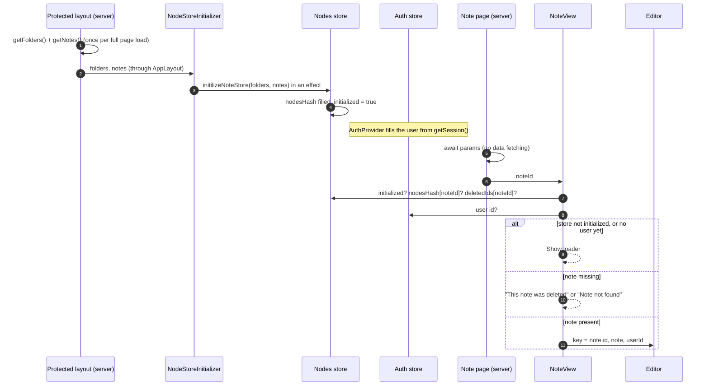
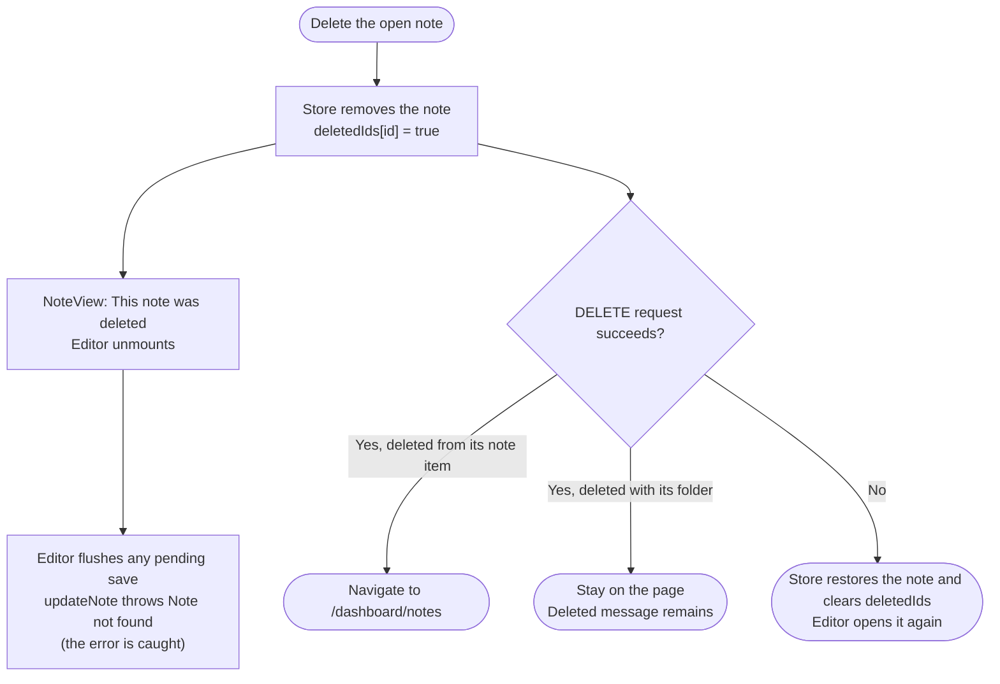
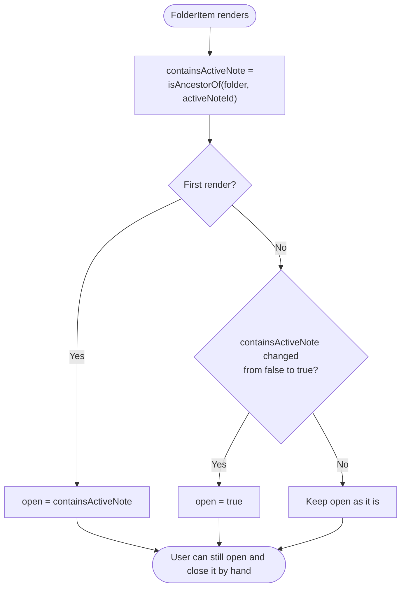

# Note loading and explorer navigation

This document covers two related features:

1. **Opening notes from the store** (Part A). Opening a note reads it from the client store, which already holds every note, instead of fetching it from the server again.
2. **Explorer navigation** (Part B). The open note is highlighted in the explorer, its folders open automatically (also after a reload), and a breadcrumb in the header shows where the note lives.

Each part explains the problem, how the code works now, every file that was created, changed, or removed and why, the edge cases, and the known limits.

For what happens *inside* the editor once it is open (drafts, autosave, conflicts), see [note-editor-flow.md](note-editor-flow.md).

**Read the [visual HTML version](note-loading-and-navigation.html) in a browser for rendered diagrams, zoom controls, and navigation.** It works offline. The Mermaid diagrams below are the editable source for those visuals.

## Reading guide

- [Part A — Opening notes from the store](#part-a--opening-notes-from-the-store)
  - [A1. The problem](#a1-the-problem)
  - [A2. The decision](#a2-the-decision)
  - [A3. How opening a note works now](#a3-how-opening-a-note-works-now)
  - [A4. What the note page shows](#a4-what-the-note-page-shows)
  - [A5. Deleting the open note](#a5-deleting-the-open-note)
  - [A6. Files](#a6-files)
  - [A7. Known limits](#a7-known-limits)
- [Part B — Explorer navigation](#part-b--explorer-navigation)
  - [B1. What the user sees](#b1-what-the-user-sees)
  - [B2. Finding the active note](#b2-finding-the-active-note)
  - [B3. Highlighting the active note](#b3-highlighting-the-active-note)
  - [B4. Opening folders along the path](#b4-opening-folders-along-the-path)
  - [B5. The breadcrumb](#b5-the-breadcrumb)
  - [B6. Files](#b6-files)
  - [B7. Known limits](#b7-known-limits)
- [Tests](#tests)

---

## Part A — Opening notes from the store

### A1. The problem

Before this change, every note was loaded twice:

| Where | What it loaded |
| --- | --- |
| Protected layout | `getNotes()` with `select("*")`: **every note including its full content**. Explorer then put them all in the nodes store. |
| Note page | `getNote(noteId)`: the same note again, fetched on the server each time a note was opened. |

That caused four problems:

1. **Slow switching.** Every click on a note waited for a server request and a database query, and showed a loader, even though the store already had the note.
2. **A crash when creating a note.** A new note is added to the store immediately and the page navigates to it, while its `POST` request may still be running. The page's `getNote` could run before the row existed; `data[0]` was then `undefined` and the page crashed.
3. **An empty store on mobile.** The store was filled by an effect inside `Explorer`. On mobile the sidebar is a sheet, and its content is **not mounted while the sheet is closed**, so the store stayed empty until the user opened the sidebar.
4. **Lost edits on mobile.** Every time the sheet reopened, `Explorer` mounted again and refilled the store from the layout's snapshot, which is taken once per full page load. Anything saved since then was replaced by older data.

A workaround, `ensureNode`, also existed only because of the old design: the editor seeded its own server-fetched note into the store before saving, since the store might not be filled yet on a directly loaded page.

### A2. The decision

There are two consistent designs. Mixing them ("use the store if the note is there, otherwise fetch it") would mean two sources of truth for the same note.

| | A. Load everything, read from the store (**chosen**) | B. Load a light list, fetch each note when opened |
| --- | --- | --- |
| Layout query | All notes with content (unchanged) | Only `id, title, folderId, createdAt, updatedAt` |
| Opening a note | Instant; no database query | Server fetch and loader every time |
| Scales to many or large notes | Poorly: the first load carries all content | Well |
| Fit with existing code | Good: `updateNote` already expects the full note in the store | Needs a separate metadata type; `updateNote` would have to stop sending the whole note |

Option A was chosen because the store was already built around full notes, a personal notes app rarely holds enough data for the first load to be a problem, and switching notes becomes instant. **If the first load becomes slow, move to option B.**

### A3. How opening a note works now

Key points:

- **The store is filled once, by a component that is always mounted.** `NodeStoreInitializer` renders nothing; it lives in `AppLayout`, which never unmounts, so the mobile sheet no longer matters. The layout's props only change on a full load or a server refresh (for example `router.refresh()`), and then the store is replaced with fresh server data.
- **The store is only ever filled in the browser.** A zustand store is a module-level object. On the server it would be shared by every request, so filling it during server rendering could leak one user's notes into another user's page. Filling it in an effect guarantees it only happens in the browser. During server rendering `NoteView` shows the loader; the editor is browser-only (`ssr: false`) anyway.
- **The `initialized` flag separates "not loaded yet" from "does not exist".** An empty `nodesHash` alone cannot tell the two apart; without the flag, a reload would briefly show "Note not found".
- **The page waits for the user id.** Local drafts are stored per user (`note-draft:v1:<userId>:<noteId>`), and the editor reads the draft on its very first render. The old page got the id from the server. It now comes from the client auth store, which `AuthProvider` fills asynchronously, so `NoteView` shows the loader until it is there. This reads the session from the browser; no server call is needed.
- **The editor gets `key={note.id}`.** BlockNote reads its starting content once. The key guarantees a fresh editor, and a fresh draft check, for every note.
- **The editor receives the live store note.** The store replaces the note object after every save, so the editor re-renders with the new object. This is safe: the starting content and the draft decision are only read on mount, and the save and draft hooks depend on `note.id`, not on the object. As a bonus, the "Edited" date and the breadcrumb title now update live.
- **Navigation still makes one small request.** The note route is dynamic, so Next.js requests the page payload from the server, but that request no longer queries the database or authenticates the user.

### A4. What the note page shows

| Condition | Shown |
| --- | --- |
| Store not initialized, or user id not known yet | Loader |
| Note not in the store, and deleted in this session | "This note was deleted" |
| Note not in the store otherwise (bad link, or an id that is a folder) | "Note not found" |
| Note in the store | Editor, with created/edited dates and tags above it |

### A5. Deleting the open note

Deleting is optimistic: `removeNote` (and `removeFolder`, for every note inside) removes the note from the store **before** the `DELETE` request finishes, and records its id in `deletedIds`.

- The deleted message matters for folder deletion. Deleting a folder does not navigate away, so without it the page would show "Note not found" (or, before the `initialized` flag, a loader forever).
- `deletedIds` is still needed after `ensureNode` was removed. If a save is in flight when the note is deleted and that save then fails, its rollback would put the note back into the store. `updateNote` checks `deletedIds` and skips the rollback.

### A6. Files

**Created**

| File | Why |
| --- | --- |
| [NoteView.tsx](../features/nodes/components/NoteView.tsx) | Client component that reads the note from the store and chooses between loader, deleted, not found, and editor ([A4](#a4-what-the-note-page-shows)). It replaced the server-side `NoteDataFetcher`. It now also passes the dates and tags to the editor through its `meta` prop, a change made with the tags feature. |
| [NodeStoreInitializer.tsx](../features/nodes/components/NodeStoreInitializer.tsx) | Fills the nodes store from the layout's data. It moved here out of `Explorer` so it runs even while the mobile sidebar is closed and runs only once ([A1](#a1-the-problem), problems 3 and 4). It has since also been used to load the stars and tags store. |

**Changed**

| File | Change | Why |
| --- | --- | --- |
| [page.tsx](../app/%28protected%29/dashboard/notes/%5Bnote%5D/page.tsx) (note page) | Only awaits `params` and renders `NoteView`. Removed `getNote`, `getUser`, and the `Suspense` fallback. | Nothing on this page loads data anymore. `params` is a promise in this Next.js version, as before. |
| [nodes.store.ts](../features/nodes/store/nodes.store.ts) | Added `initialized` (set by `initilizeNoteStore`). Removed `ensureNode`. Updated the `deletedIds` comment. | See [A3](#a3-how-opening-a-note-works-now). `ensureNode` is no longer needed because the editor only mounts once the note is already in the store. |
| [use-note-server-save.ts](../features/nodes/hooks/use-note-server-save.ts) | Removed the `ensureNode` call and the `noteRef` that only existed to feed it. | Same reason. |
| [AppLayout.tsx](../shared/components/layout/AppLayout.tsx) | Renders `<NodeStoreInitializer folders notes />`; no longer passes the data to `AppSidebar`. | `AppLayout` is always mounted. |
| [AppSidebar.tsx](../shared/components/layout/AppSidebar.tsx) | No longer takes `folders` and `notes`. | It only passed them to `Explorer`. |
| [Explorer.tsx](../features/nodes/components/Explorer.tsx) | No longer takes props or fills the store; it only reads from it. | Moved to `NodeStoreInitializer`. |
| [nodes.service.ts](../features/nodes/api/nodes.service.ts), [server.ts](../features/nodes/server.ts) | Removed `getNote`. | No remaining callers. |
| [index.ts](../features/nodes/index.ts) | Exports `NoteView` and `NodeStoreInitializer`. | Used by the page and the layout. |
| [nodes.store.test.ts](../features/nodes/store/nodes.store.test.ts) | Tests that seeded notes with `ensureNode` now check that `updateNote` rejects a deleted note, and that a note restored after a failed delete can be saved. | Same guarantees, without `ensureNode`. |
| [note-editor-flow.md](note-editor-flow.md) | Updated where it described the server fetch and `ensureNode`. | Keep that document accurate. |

### A7. Known limits

| Situation | Behavior |
| --- | --- |
| Many or very large notes | The first load includes every note's full content. Move to option B ([A2](#a2-the-decision)) if this becomes slow. |
| Note edited in another tab or on another device | Not visible until a full reload. Previously every opening fetched the latest version. |
| Server refresh while a save is in flight | The store is replaced with the server's data, which may not include that save yet. The editor keeps its content and saves again on the next change. |
| A new note that was never saved, then reloaded | `addNote` does not send `createdAt`, so the database assigns its own. A local draft for such a note was based on the browser's `createdAt`, so after a reload it shows the conflict banner instead of restoring silently. Nothing is lost. Sending `createdAt` in `addNote` would remove this. |

---

## Part B — Explorer navigation

### B1. What the user sees

- The open note is **highlighted** in the explorer (accent background, medium weight).
- On a **reload** or a direct link, every folder on the path to the open note starts **open**, and the note is **scrolled into view**.
- Opening a note inside a closed folder any other way (for example from search) also opens its folders.
- The header shows a **breadcrumb**: home icon / colored folder icons with names / note title.

For example: `⌂ / 📁 Work / 📁 Meetings / Q4 planning meeting`, with each folder icon in that folder's color.

### B2. Finding the active note

[use-active-note-id.ts](../features/nodes/hooks/use-active-note-id.ts) returns the `note` route parameter using `useParams()`. `useParams` works in any client component, including the sidebar and header, which live in the layout rather than the page. On any other route it returns `undefined`.

Every part of this feature, and the delete handling in `NoteItem`, reads the active note this way, instead of each splitting the URL itself.

### B3. Highlighting the active note

[NoteItem.tsx](../features/nodes/components/NoteItem.tsx):

- Sets `aria-current="page"` on the active note's button and styles it with `aria-[current=page]:…` classes. The attribute also tells screen readers which note is open.
- When the note becomes active, calls `scrollIntoView({ block: "nearest" })`. `nearest` does nothing if the note is already visible, so clicking a visible note never jumps the list. Its folders are already open at that point ([B4](#b4-opening-folders-along-the-path)), so the element is on screen to scroll to.
- `handleDelete` uses the same `isActive` value to decide whether to navigate away after deleting.

Search results are a flat list of the same `NoteItem`s, so the highlight also works there.

### B4. Opening folders along the path

[folder-path.ts](../features/nodes/utils/folder-path.ts) provides:

- `getAncestorFolders(nodesHash, nodeId)`: the folders containing a node, outermost first, found by following `parentId` upward. It stops at a missing parent and also stops if folders ever point to each other in a loop, so it can never hang.
- `isAncestorOf(nodesHash, folderId, nodeId)`: whether a folder is on that path.

[FolderItem.tsx](../features/nodes/components/FolderItem.tsx) used to let the collapsible manage its own open state. It now holds `open` itself:

Why it is built this way:

- **Why the first render is correct after a reload.** Folders are built from the store, which is empty until it is filled, so no `FolderItem` exists before then. By the time folders mount, the store already has every note, and the starting value is right.
- **Why folders only ever open automatically.** Closing folders you opened, or closing the path of the previous note, would fight with the user. Folders opened or closed by hand stay that way.
- **Why state is adjusted during render, not in an effect.** An effect runs after the browser paints, so the folder would flash closed for one frame before opening. Comparing with the previous value during render is React's recommended pattern for state that follows a prop, and it avoids the `set-state-in-effect` lint rule.
- **Why the store selector returns a boolean.** Each folder subscribes with `useNodeStore(state => isAncestorOf(...))`. A boolean only changes when the answer changes, so folders do not re-render for unrelated edits. The walk costs one step per folder level.

The same component also opens a folder when the user starts creating a note or folder inside it, so the inline name field is visible. That was added later, with inline creation.

**On mobile**, the explorer mounts again each time the sheet opens, so folder state resets: the active note's path is open and everything else is closed.

### B5. The breadcrumb

[NoteBreadcrumb.tsx](../features/nodes/components/NoteBreadcrumb.tsx) is rendered in the header of [AppLayout.tsx](../shared/components/layout/AppLayout.tsx), next to the sidebar toggle.

| Aspect | Behavior | Why |
| --- | --- | --- |
| When shown | Only when the active note exists in the store; otherwise renders nothing. | Section pages (Starred, Tags) show their own title in the same place through `SectionTitle`. |
| Home icon | Links to `/dashboard/notes`. | `/dashboard` only redirects there. |
| Folders | Colored folder icon and name; not clickable. | There is no page for a folder yet. |
| Note title | Last item, medium weight; updates live as the title changes. | It reads from the store, which every save updates. |
| Separators | `/` | Matches the design. |
| Long names | Folders cut at `max-w-32`, the title at the available width, both with "…". | The header is a single fixed-height line. |
| Deep paths | More than 3 folders show the first folder, "…", then the last two. Hovering "…" lists the hidden folders. | Keeps the header on one line while showing where the path starts and ends. |

The breadcrumb subscribes to the whole `nodesHash` and computes the path with `useMemo`. A store selector that returned the array directly would create a new array on every call, and zustand would treat every call as a change and re-render in a loop.

The folder color lookup was moved out of `FolderItem` into [folder-colors.ts](../features/nodes/utils/folder-colors.ts), so the explorer and the breadcrumb use the same colors.

### B6. Files

**Created**

| File | Why |
| --- | --- |
| [use-active-note-id.ts](../features/nodes/hooks/use-active-note-id.ts) | One way to read the open note id from anywhere ([B2](#b2-finding-the-active-note)). |
| [folder-path.ts](../features/nodes/utils/folder-path.ts) | Folder path lookup shared by the folders and the breadcrumb ([B4](#b4-opening-folders-along-the-path)). |
| [folder-path.test.ts](../features/nodes/utils/folder-path.test.ts) | Tests for the path lookup ([Tests](#tests)). |
| [folder-colors.ts](../features/nodes/utils/folder-colors.ts) | Folder color classes, previously private to `FolderItem`. |
| [NoteBreadcrumb.tsx](../features/nodes/components/NoteBreadcrumb.tsx) | The header breadcrumb ([B5](#b5-the-breadcrumb)). |

**Changed**

| File | Change | Why |
| --- | --- | --- |
| [NoteItem.tsx](../features/nodes/components/NoteItem.tsx) | Active highlight, scroll into view, `isActive` in delete. Replaced `usePathname().split("/")` with `useActiveNoteId`. | [B3](#b3-highlighting-the-active-note) |
| [FolderItem.tsx](../features/nodes/components/FolderItem.tsx) | Holds its own open state and opens along the active path. Uses `folderColorClass`. | [B4](#b4-opening-folders-along-the-path) |
| [AppLayout.tsx](../shared/components/layout/AppLayout.tsx) | Header renders `NoteBreadcrumb`; added `gap-3`. | [B5](#b5-the-breadcrumb) |
| [index.ts](../features/nodes/index.ts) | Exports `NoteBreadcrumb`. | Used by the layout. |

### B7. Known limits

| Situation | Behavior |
| --- | --- |
| Folder names in the breadcrumb | Not clickable. They could open the sidebar at that folder once there is a reason to. |
| Folder open state | Kept in each `FolderItem`, so it is lost when the explorer unmounts (mobile sheet closing, or a full reload). Only the active path is restored. |
| Note inside a folder whose parent is missing | The path stops at the last folder that exists, and the note is shown at the explorer's root (as `buildTree` does). |

---

## Tests

| Test file | Covers |
| --- | --- |
| [nodes.store.test.ts](../features/nodes/store/nodes.store.test.ts) | A deleted note, or a note in a deleted folder, cannot be saved back into the store. A note deleted while its save is in flight is not restored when the save fails. A failed delete restores the note and it can be saved again. |
| [folder-path.test.ts](../features/nodes/utils/folder-path.test.ts) | Path order (outermost first); root notes and unknown ids; a missing parent; a parent loop; `isAncestorOf` for folders on and off the path. |

Run with `pnpm test` (Vitest). The UI behavior (loader, deleted message, highlight, auto-open, breadcrumb) has no automated tests; check it by hand after changes.
